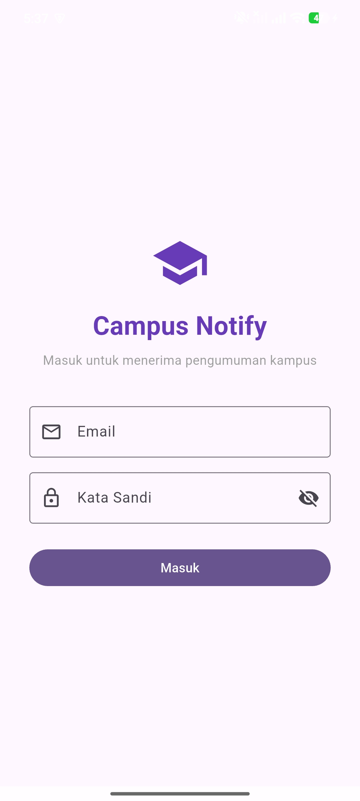
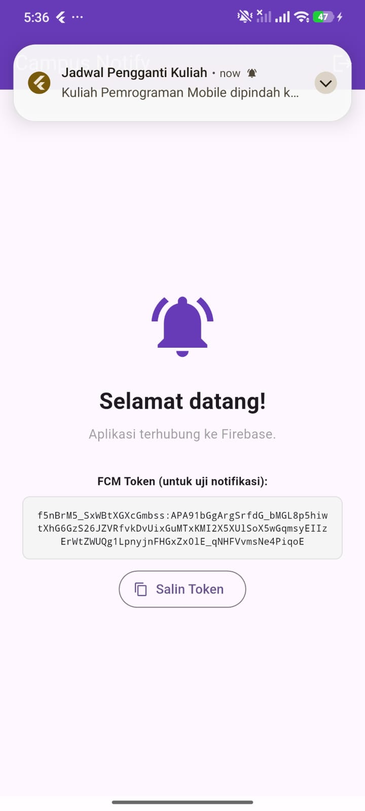
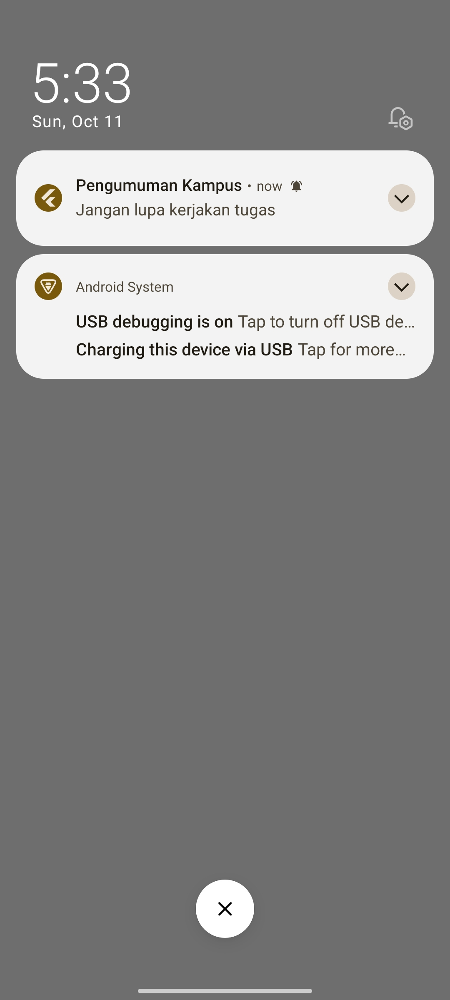
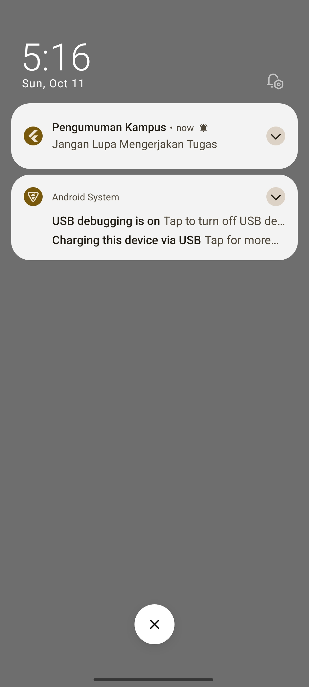
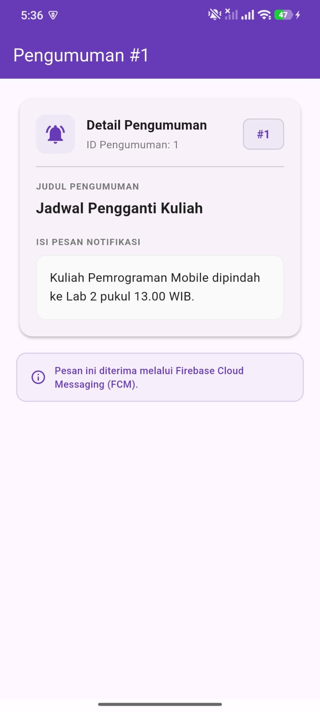
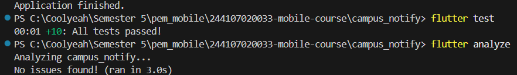

# Campus Notify

Proyek Praktikum Week 6: Authentication, Security & Firebase Cloud Messaging (FCM).

---

## 1. Tujuan Praktikum

- Mengimplementasikan autentikasi berbasis token dengan guard routing menggunakan GoRouter dan Riverpod.
- Menyimpan token autentikasi (access token dan refresh token) secara aman pada hardware-backed storage (`flutter_secure_storage`).
- Mengonfigurasi Dio Interceptor untuk penanganan auto-refresh token (status code 401) dan auto-logout saat refresh token kedaluwarsa.
- Mengintegrasikan push notification multi-state (Foreground, Background, Terminated) menggunakan Firebase Cloud Messaging (FCM) dan `flutter_local_notifications`.
- Menangani deep link notifikasi yang mengarahkan pengguna langsung ke halaman detail pengumuman (`/pengumuman/:id`) beserta konten pesan.

---

## 2. Fitur Utama

- **Autentikasi & Guard Route**: Sesi login diverifikasi otomatis; rute privat terkunci bila pengguna belum login.
- **Secure Token Storage**: Token disimpan di Android Keystore / iOS Keychain, terlindungi dari risiko kebocoran SharedPreferences.
- **Auto-Refresh Sesi**: Interceptor Dio memperbarui access token otomatis saat menerima 401 tanpa interupsi pengguna.
- **Push Notification 3 State**: Menerima dan menangani notifikasi saat aplikasi aktif (foreground), diminimalkan (background), maupun ditutup total (terminated).
- **Deep Linking & Payload Parsing**: Klik banner notifikasi membuka detail pengumuman spesifik beserta judul dan isi pesan.
- **Topic Messaging**: Berlangganan topik `pengumuman-kampus` untuk distribusi pesan siaran massal.

---

## 3. Stack Teknologi

| Komponen | Paket / Teknologi | Fungsi |
|---|---|---|
| State Management | `flutter_riverpod` | Manajemen state auth dan dependensi global |
| Routing & Deep Link | `go_router` | Navigasi deklaratif dan rute dinamis `/pengumuman/:id` |
| HTTP Client | `dio` | Request API dan interceptor token refresh |
| Keamanan Token | `flutter_secure_storage` | Penyimpanan token terenkripsi |
| Push Notification | `firebase_messaging` | Layanan FCM token, topik, dan remote message |
| Local Notification | `flutter_local_notifications` | Menampilkan banner lokal saat foreground |

---

## 4. Cara Menjalankan & Hasil Pengujian

### Menjalankan Aplikasi
```bash
flutter pub get
flutter run
```

### Menjalankan Unit Test & Analisis Statis
```bash
flutter test
flutter analyze
```

Semua 10 unit test (parsing rute, penanganan payload, logika sesi token, token refresh, dan UI announcement) lulus tanpa kendala, dan `flutter analyze` bersih (No issues found) — bukti tangkapan layar terlampir pada tabel bagian 6.

---

## 5. Matriks Pengujian Push Notification

Pengujian notifikasi dilakukan pada perangkat fisik dengan skenario pengiriman melalui Firebase Cloud Messaging:

| State Aplikasi | Skenario Pengujian | Hasil Pengujian | Status |
|---|---|---|---|
| **Foreground** (Aplikasi sedang aktif terbuka) | Aplikasi dibuka, pesan dikirim dari FCM. Banner lokal muncul via `flutter_local_notifications`. | Banner lokal muncul di bagian atas layar. Saat diklik, aplikasi langsung bernavigasi ke halaman detail pengumuman. | Berhasil |
| **Background** (Aplikasi diminimalkan / tekan tombol Home) | Aplikasi diminimalkan, pesan dikirim dari FCM. Banner notifikasi sistem muncul. | Notifikasi sistem muncul di bilah status. Saat diklik, aplikasi terbuka dan langsung menuju detail pengumuman. | Berhasil |
| **Terminated** (Aplikasi ditutup total / swipe-close) | Aplikasi di-force close, pesan dikirim dari FCM. Banner notifikasi sistem muncul. | Notifikasi sistem muncul. Saat banner diklik, aplikasi diinisialisasi dan langsung membuka halaman detail pengumuman. | Berhasil |

---

## 6. Bukti Tangkapan Layar (Screenshots)

| Screenshot | Fitur / Keterangan |
| :---: | :--- |
|  | **1. Autentikasi & FCM Token**<br>Tampilan antarmuka login dan halaman utama setelah autentikasi berhasil, menampilkan FCM token unik perangkat untuk pengujian push notification. |
|  | **2. Notifikasi State Foreground**<br>Banner notifikasi lokal muncul di bagian atas layar saat aplikasi sedang aktif terbuka menggunakan `flutter_local_notifications`. |
|  | **3. Notifikasi State Background**<br>Banner notifikasi sistem muncul pada status bar ketika aplikasi diminimalkan (ditekan tombol Home) saat pesan FCM diterima. |
|  | **4. Notifikasi State Terminated**<br>Notifikasi sistem muncul pada perangkat saat aplikasi dalam kondisi ditutup total (swipe-close / terminated). |
|  | **5. Hasil Navigasi Deep Link Notifikasi**<br>Halaman detail pengumuman (`/pengumuman/:id`) yang langsung terbuka setelah banner notifikasi diklik, menampilkan ID pengumuman, judul, dan isi pesan notifikasi lengkap. |
|  | **6. Hasil Flutter Analyze & Flutter Test**<br>Pengujian statis `flutter analyze` bersih tanpa issue dan seluruh 10 unit test lulus (`All tests passed!`). |

---

## 7. Refleksi Praktikum

### 1. Mengapa refresh token tidak boleh disimpan di SharedPreferences?
SharedPreferences menyimpan data dalam format file XML teks biasa yang tidak terenkripsi pada penyimpanan internal perangkat. Pada perangkat yang di-root atau melalui fitur backup debugging (ADB), file ini dapat diekstraksi dan dibaca dengan mudah.

Refresh token memiliki masa berlaku yang panjang (mingguan hingga bulanan). Jika refresh token bocor, penyerang dapat menerbitkan access token baru secara terus-menerus tanpa perlu mengetahui kata sandi pengguna. Oleh karena itu, refresh token wajib disimpan pada `flutter_secure_storage` yang memanfaatkan Android Keystore atau iOS Keychain yang terisolasi secara hardware dan terenkripsi.

### 2. Apa yang rusak bila `onTokenRefresh` diabaikan?
FCM registration token bersifat dinamis dan dapat berubah sewaktu-waktu akibat pembaruan aplikasi, pembersihan cache/data, rotasi keamanan otomatis oleh Firebase, atau pemulihan perangkat ke HP baru.

Jika listener `onTokenRefresh` tidak diimplementasikan, backend server akan tetap menyimpan token lama yang sudah usang (stale token). Akibatnya:
- Pesan notifikasi gagal terkirim ke perangkat pengguna.
- Backend tidak selalu mendapatkan error seketika karena FCM hanya menandai token lama sebagai unregistered.
- Seiring berjalannya semester, perangkat mahasiswa tidak lagi menerima pengumuman penting perkuliahan.

### 3. Kapan memakai topik vs token perangkat?
- **Topik (Topic Messaging)** digunakan untuk pengiriman pesan massal (broadcast) satu arah ke banyak pengguna tanpa data sensitif:
  - Contoh: Pengumuman libur akademik (`pengumuman-kampus`).
  - Contoh: Informasi kegiatan organisasi mahasiswa (`ukm-olahraga`).
- **Token Perangkat (Device Token)** digunakan untuk pesan personal atau transaksional yang ditujukan khusus kepada satu pengguna tertentu:
  - Contoh: Notifikasi penerbitan nilai UTS/UAS individual mahasiswa.
  - Contoh: Pengingat tagihan pembayaran UKT/SPP yang memuat nominal pribadi.

Aturan praktis: Jika informasi aman dibaca oleh seluruh mahasiswa tanpa melanggar privasi, gunakan topik. Jika informasi bersifat rahasia dan spesifik milik satu individu, gunakan token perangkat.

### 4. Bagian draf AI yang ditolak atau diperbaiki
Dalam implementasi awal dibantu oleh AI coding assistant, terdapat beberapa hal yang ditolak atau diperbaiki secara manual:
- **Pencetakan token penuh di log console**: AI sempat mencetak token FCM secara lengkap menggunakan `print(token)`. Hal ini ditolak karena token adalah kredensial akses sensitif. Diperbaiki dengan hanya mencetak panjang karakter token.
- **Hardcoding rute navigasi**: AI menulis string rute langsung di dalam handler (`/pengumuman/3`). Diperbaiki dengan memusatkan seluruh rute pada kelas konstanta `AppRoutes` di `lib/routes.dart`.
- **Navigasi klik foreground & terminated yang terlewat**: Draf awal AI hanya menyimpan rute ke variabel tanpa memicu perpindahan layar pada callback `flutter_local_notifications`, dan tidak memperhitungkan proses loading async autentikasi saat aplikasi terminated. Diperbaiki dengan mengintegrasikan callback navigasi langsung dan memastikan sesi dimuat sebelum GoRouter mengevaluasi deep link.
- **Penerusan konten judul dan pesan**: Draf awal AI hanya meneruskan path rute ID pengumuman tanpa menyertakan judul dan isi pesan notifikasi ke halaman detail. Diperbaiki dengan mengekstrak payload notifikasi ke `AnnouncementPage`.
