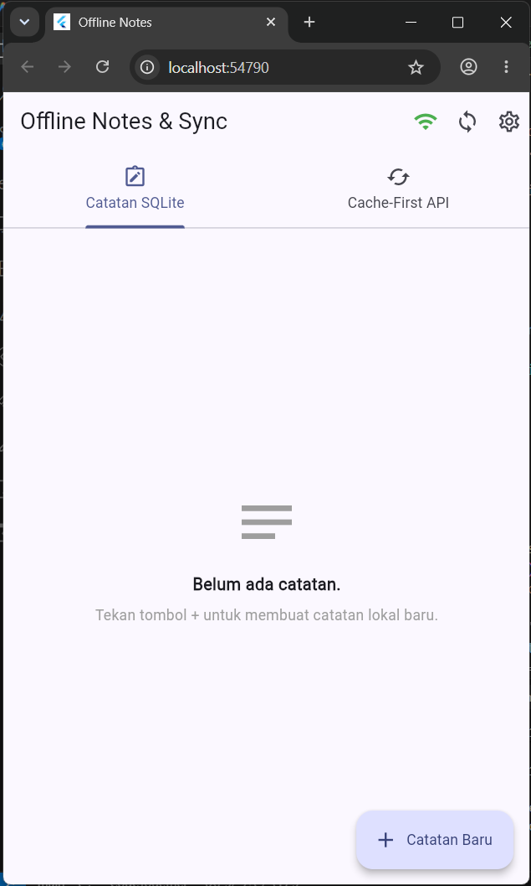
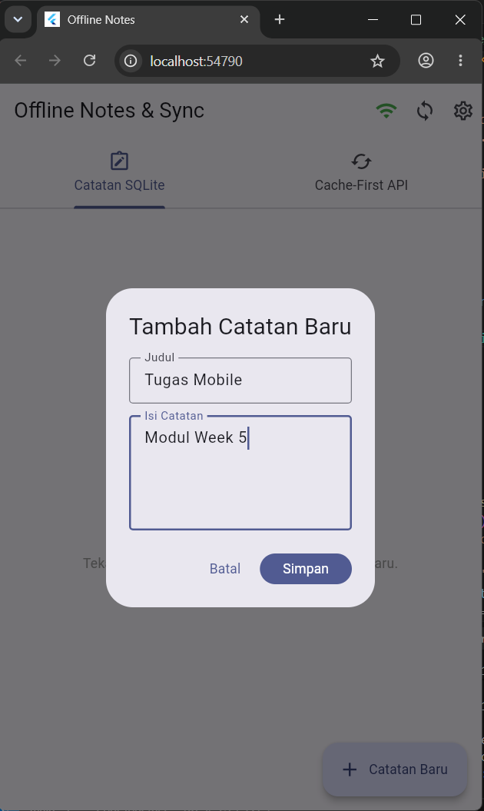
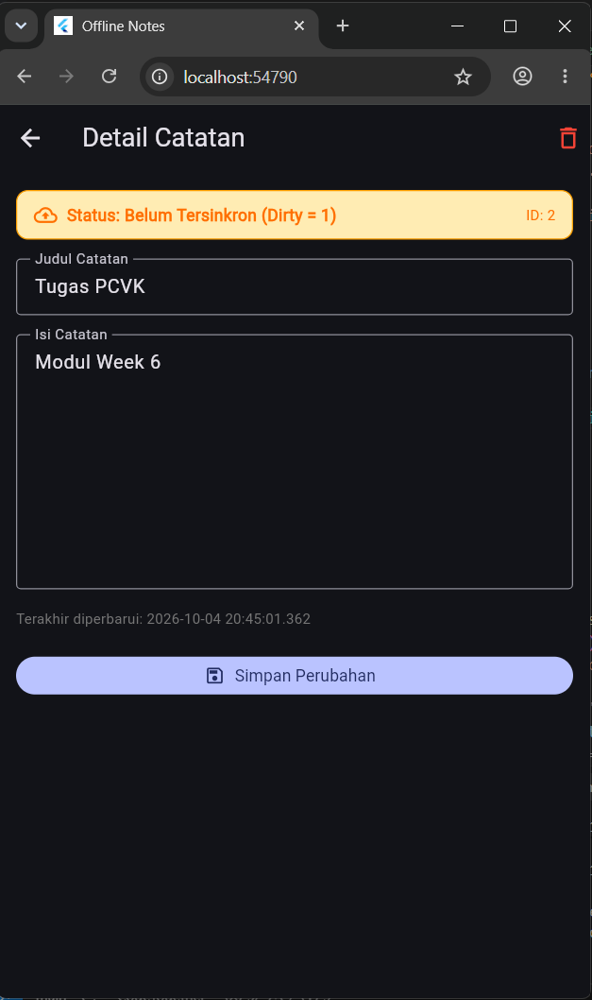
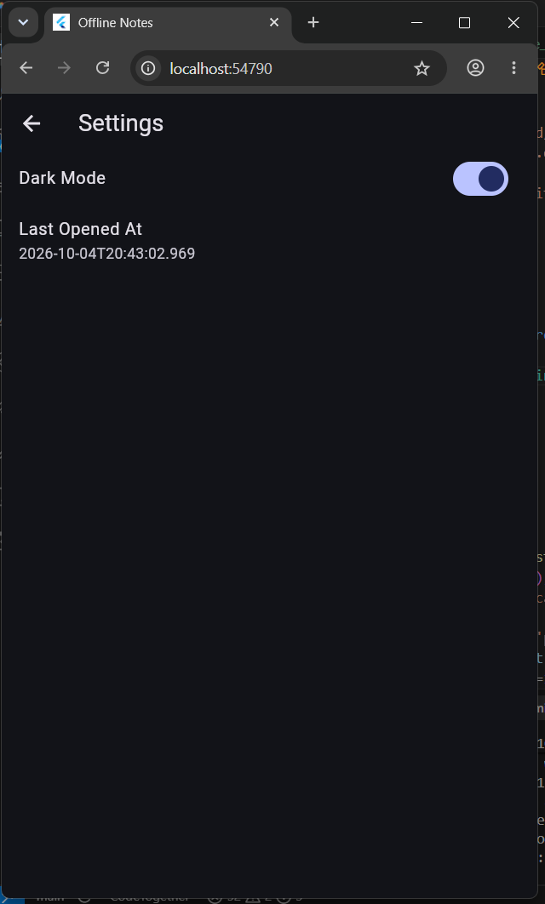

# 🏛️ Week 7 — Clean Architecture

Proyek Praktikum Week 7: Implementasi **Clean Architecture (Feature-First)** pada aplikasi Flutter (`clean_notes_app`).

---

## 1. Tujuan Pembelajaran

Setelah menyelesaikan modul praktikum ini, mahasiswa mampu:

- Menjelaskan prinsip **SOLID** dan *Separation of Concerns* dengan contoh kode nyata di Flutter.
- Membedakan struktur arsitektur **feature-first** vs **layer-first** beserta analisis *trade-off*-nya.
- Mengimplementasikan tiga layer utama (**Presentation**, **Domain**, **Data**) dan mematuhi aturan emas dependensi (*Dependency Rule*: dependensi hanya mengarah ke dalam).
- Membedakan peran **Entity** murni vs **Model** data, serta fungsi **Repository Interface**, **Use Case**, dan **Dependency Injection (DI)**.
- Merefaktor proyek berbasis penyimpanan lokal/offline-first menjadi struktur *feature-first Clean Architecture*.
- Menguji domain dan *use case* secara independen menggunakan **repository palsu (Fake Repository)** tanpa database atau jaringan fisik.
- Membuktikan sterilitas layer melalui verifikasi *static analysis* dan pencarian pola (*ripgrep sterility checks*).

---

## 2. Arsitektur & Diagram Layer

Aplikasi menerapkan **Clean Architecture** dengan pendekatan **Feature-First**. Setiap fitur mengisolasi ketiga layernya sendiri, dengan aturan dependensi yang ketat:

```
┌─────────────────────────────────────────────────────────────┐
│                     PRESENTATION LAYER                      │
│     (Pages, Widgets, Riverpod Providers, Notifiers)        │
└──────────────────────────────┬──────────────────────────────┘
                               │ bergantung ke (imports)
                               ▼
┌─────────────────────────────────────────────────────────────┐
│                        DOMAIN LAYER                         │
│       (Entities, Repository Interfaces, Use Cases, Failures) │
│                ★ THE CORE — PURE DART ★                    │
└──────────────────────────────▲──────────────────────────────┘
                               │ diimplementasikan oleh
                               │ (implements & maps to entity)
┌──────────────────────────────┴──────────────────────────────┐
│                         DATA LAYER                          │
│    (Models + toMap/fromMap, Repository Impl, SQLite Datasource)│
└─────────────────────────────────────────────────────────────┘
```

### Aturan Kunci (The Golden Dependency Rule)
1. **Domain adalah Pusat Bisnis (The Core)**: Ditulis murni dalam bahasa Dart tanpa dependensi framework Flutter UI, package SQLite, SharedPreferences, Dio, maupun Firebase.
2. **Dependensi Mengarah ke Dalam**: Presentation bergantung pada abstraksi Domain. Data layer mengimplementasikan kontrak Domain.
3. **Entity vs Model**: Entity di `domain/entities` murni objek bisnis tanpa fungsi serialisasi. Model di `data/models` menangani konversi `toMap()`, `fromMap()`, dan `.toEntity()`.
4. **Dependency Injection**: Penyuntikan dependensi diatur terpusat melalui Riverpod Provider (`notes_providers.dart` & `settings_providers.dart`). Widget tidak pernah melakukan instansiasi manual (`new Repository()`).

---

## 3. Struktur Proyek (Feature-First)

```
07-week-7-clean-architecture/
├── lib/
│   ├── main.dart                                   # Entry point + ProviderScope + tema
│   ├── routes.dart                                 # GoRouter + parsing rute murni
│   ├── core/                                       # Inti lintas fitur (Murni Dart)
│   │   ├── failures.dart                           # Failure domain (Local, Network, Validation)
│   │   └── format.dart                             # Fungsi murni formatting & route parser
│   └── features/
│       ├── notes/                                  # Fitur Utama: Manajemen Catatan
│       │   ├── domain/                             # DOMAIN LAYER (Pure Dart)
│       │   │   ├── entities/
│       │   │   │   └── note.dart                   # Entity bisnis Note
│       │   │   ├── repositories/
│       │   │   │   └── note_repository.dart        # Kontrak abstrak interface
│       │   │   └── usecases/
│       │   │       ├── get_notes.dart              # UseCase: Ambil daftar catatan
│       │   │       ├── add_note.dart               # UseCase: Tambah catatan + validasi
│       │   │       ├── update_note.dart            # UseCase: Perbarui catatan
│       │   │       └── delete_note.dart            # UseCase: Hapus catatan
│       │   ├── data/                               # DATA LAYER
│       │   │   ├── datasources/
│       │   │   │   └── notes_database.dart         # SQLite opener (Web/Mobile)
│       │   │   ├── models/
│       │   │   │   └── note_model.dart             # Model Note (toMap/fromMap/toEntity)
│       │   │   └── repositories/
│       │   │       └── note_repository_impl.dart  # Implementasi kontrak NoteRepository
│       │   └── presentation/                       # PRESENTATION LAYER
│       │       ├── providers/
│       │       │   └── notes_providers.dart        # Wiring DI Riverpod & state UI
│       │       ├── pages/
│       │       │   ├── notes_page.dart             # Halaman utama (List, empty, retry)
│       │       │   └── note_detail_page.dart       # Halaman detail & edit catatan
│       │       └── widgets/
│       │           └── note_tile.dart              # Widget baris catatan + badge lokal
│       └── settings/                               # Fitur Kedua: Pengaturan & Tema
│           ├── domain/                             # DOMAIN LAYER
│           │   ├── entities/
│           │   │   └── app_settings.dart           # Entity AppSettings
│           │   ├── repositories/
│           │   │   └── settings_repository.dart    # Kontrak SettingsRepository
│           │   └── usecases/
│           │       ├── get_settings.dart           # UseCase: Ambil preferensi
│           │       └── toggle_theme_mode.dart      # UseCase: Ganti tema gelap/terang
│           ├── data/                               # DATA LAYER
│           │   └── repositories/
│           │       └── settings_repository_impl.dart # Implementasi SharedPreferences
│           └── presentation/                       # PRESENTATION LAYER
│               ├── providers/
│               │   └── settings_providers.dart     # Provider DI & DarkModeNotifier
│               └── pages/
│                   └── settings_page.dart          # UI preferensi tema & riwayat buka
├── test/
│   ├── add_note_test.dart                          # Pengujian validasi bisnis AddNote
│   ├── format_test.dart                            # Pengujian fungsi murni format & parse
│   ├── get_notes_test.dart                         # Pengujian GetNotes dengan Fake Repo
│   ├── note_test.dart                              # Pengujian NoteModel & DI Riverpod
│   ├── settings_test.dart                          # Pengujian domain Settings & toggle
│   └── widget_test.dart                            # Placeholder widget test
├── docs/
│   └── AI_CHALLENGE.md                             # Dokumentasi evaluasi AI & trade-offs
├── screenshots/                                    # Bukti tangkapan layar pengujian
└── README.md                                       # Laporan praktikum lengkap
```

---

## 4. Stack Teknologi

| Komponen | Paket / Teknologi | Fungsi dalam Arsitektur |
|---|---|---|
| Framework | Flutter SDK 3.x / Dart 3.x | Framework UI & logika aplikasi |
| State Management & DI | `flutter_riverpod ^3.4.3` | Dependency Injection & reaktivitas state UI |
| Routing Declarative | `go_router ^18.0.2` | Navigasi deklaratif berbasis path |
| Relational Database | `sqflite ^2.4.4` | Penyimpanan lokal persisten tabel `notes` |
| Web Database Engine | `sqflite_common_ffi_web ^1.2.0` | Kompatibilitas SQLite di browser |
| Key-Value Storage | `shared_preferences ^2.5.5` | Penyimpanan preferensi tema & riwayat aplikasi |
| Testing Toolkit | `flutter_test`, `sqflite_common_ffi` | Unit testing murni usecase & model |

---

## 5. Praktikum 1: Audit Layer & Tiga Pelanggaran Klasik

### 1. Tabel Audit Pemetaan File Lama ke Layer
Sebelum refactor, struktur file lama diaudit untuk mengidentifikasi kebocoran *concerns*:

| File Lama | Layer Lama | Masalah yang Ditemukan | Aksi Refactoring |
|---|---|---|---|
| `pages/notes_page.dart` | Presentation | Menjalankan logika database di dialog, format tanggal mentah di UI, dan memicu reload manual. | Dipindah ke `features/notes/presentation/pages/notes_page.dart`. Aksi dialihkan via UseCase. |
| `pages/note_detail_page.dart` | Presentation | Memanggil method repository langsung tanpa pemisahan state yang rapi. | Dipindah ke `features/notes/presentation/pages/note_detail_page.dart` menggunakan `noteDetailProvider(id)`. |
| `data/local/note.dart` | Data / Domain | Objek bisnis dan serialisasi database (`toMap`, `fromMap`) bersatu dalam 1 kelas. | Dipecah menjadi Entity murni `Note` di domain dan `NoteModel` di data layer. |
| `data/local/db.dart` | Data | Terbuka global di `data/`. | Dipusatkan ke datasource `features/notes/data/datasources/notes_database.dart`. |
| `data/repositories/note_repository.dart` | Data | Interface dan implementasi menyatu, tidak ada kontrak abstract yang dapat di-mock. | Dipecah menjadi interface `NoteRepository` di domain dan `NoteRepositoryImpl` di data. |
| `data/prefs.dart` | Data | Digunakan langsung oleh Notifier tanpa pemisahan kontrak domain. | Direfaktor ke interface `SettingsRepository` (domain) dan `SettingsRepositoryImpl` (data). |

---

## 6. Verifikasi Sterilitas & Hasil Pengujian

### 1. Tiga Perintah Grep Sterilitas (Semua Lolos / 0 Hasil)

Sesuai instruksi modul, ketiga pemeriksaan sterilitas dijalankan untuk memastikan tidak ada pelanggaran aturan dependensi:

```bash
# Pemeriksaan 1: Presentation steril dari data mentah & storage langsung
rg "Dio\(|openDatabase|getDatabasesPath|FlutterSecureStorage|SharedPreferences\.getInstance|jsonDecode" lib/features/*/presentation lib/pages
# HASIL: 0 matches (Steril total / Lolos)

# Pemeriksaan 2: Domain steril dari framework Flutter, SQLite, Dio, dan Firebase
rg "import 'package:flutter|import 'package:dio|import 'package:sqflite|import 'package:firebase" lib/features/*/domain lib/core
# HASIL: 0 matches (Steril total / Lolos)

# Pemeriksaan 3: Tidak ada instansiasi manual (DI bocor) di UI Widget
rg "Repository\(|Dio\(BaseOptions" lib/features/*/presentation/pages lib/features/*/presentation/widgets
# HASIL: 0 matches (Steril total / Lolos)
```

### 2. Static Analysis (`flutter analyze`)
```bash
flutter analyze
```
**Hasil:**
```text
Analyzing 07-week-7-clean-architecture...                       
No issues found! (ran in 3.0s)
```

### 3. Eksekusi Unit Test (`flutter test`)
```bash
flutter test
```
**Hasil:**
```text
00:00 +0: C:/.../test/add_note_test.dart: AddNote UseCase Test (Validation & Domain Logic) Gagal validasi jika judul kosong atau hanya spasi
00:00 +1: C:/.../test/add_note_test.dart: AddNote UseCase Test (Validation & Domain Logic) Berhasil menyimpan catatan dengan judul valid dan melakukan trim
00:00 +2: C:/.../test/format_test.dart: Core Pure Format & Route Parser Tests formatDisplayDate memformat DateTime ke format DD/MM/YYYY HH:mm
00:00 +3: C:/.../test/format_test.dart: Core Pure Format & Route Parser Tests parseRouteId mengurai string angka dan menangani null/kosong/invalid
00:00 +4: C:/.../test/format_test.dart: Core Pure Format & Route Parser Tests formatNoteSnippet memotong teks panjang dan membersihkan newline
00:00 +5: C:/.../test/get_notes_test.dart: GetNotes UseCase Test (Pure Domain) GetNotes meneruskan daftar dari repository
00:00 +6: C:/.../test/get_notes_test.dart: GetNotes UseCase Test (Pure Domain) GetNotes meneruskan failure tanpa melempar exception
00:00 +7: C:/.../test/note_test.dart: NoteModel Data Layer Tests fromMap aman terhadap field yang hilang dan mengonversi ke default
00:00 +8: C:/.../test/note_test.dart: NoteModel Data Layer Tests flag dirty bertahan pada serialisasi model
00:00 +9: C:/.../test/note_test.dart: NoteModel Data Layer Tests toEntity menghasilkan domain entity murni tanpa method serialisasi
00:00 +10: C:/.../test/note_test.dart: Presentation Provider DI Wiring Tests provider sukses dengan repository palsu disuntikkan
00:00 +11: C:/.../test/note_test.dart: Presentation Provider DI Wiring Tests provider error menangkap Failure dan melempar Exception ramah UI
00:00 +12: C:/.../test/settings_test.dart: Settings Feature Domain Tests GetSettings mengembalikan entity AppSettings murni
00:00 +13: C:/.../test/settings_test.dart: Settings Feature Domain Tests ToggleThemeMode membalik nilai state dark mode
00:00 +14: C:/.../test/settings_test.dart: Settings Feature Domain Tests ToggleThemeMode mempertahankan mode lama saat repository gagal
00:00 +15: C:/.../test/widget_test.dart: placeholder
00:00 +16: All tests passed!
```
Seluruh **16 unit test lulus 100%**.

---

## 7. Bukti Tangkapan Layar (Screenshots)

Berikut matriks tangkapan layar hasil implementasi antarmuka dan pengujian Clean Architecture:

| Tangkapan Layar | Fitur / Komponen | Penjelasan Teknis |
| :---: | :--- | :--- |
|  | **1. Halaman Utama Catatan** | Menampilkan daftar catatan dari SQLite melalui `notesProvider` dan `GetNotes` use case, dilengkapi badge lokal dan tab penjelasan layer. |
|  | **2. Tambah Catatan Baru** | Dialog penambahan catatan baru yang memvalidasi judul via `AddNote` usecase, menghasilkan entity baru dan invalidasi provider reaktif. |
|  | **3. Detail & Edit Catatan** | Halaman `/note/:id` untuk memperbarui judul dan isi catatan via `UpdateNote` usecase tanpa menyentuh SQL langsung di widget. |
|  | **4. Pengaturan & Tema Gelap** | Halaman `/settings` fitur kedua (`features/settings`) yang mengelola tema melalui `ToggleThemeMode` usecase dan SharedPreferences. |
|  | **5. Penanda Data Lokal** | Menampilkan badge *Lokal* pada tile catatan yang baru ditambahkan sesuai `dirty flag` pada SQLite database. |
|  | **6. Flutter Analyze & Flutter Test** | Bukti eksekusi terminal yang menunjukkan `flutter analyze` bersih (No issues found) dan seluruh 16 unit test lulus (`All tests passed!`). |

---

## 8. Refleksi Praktikum

### 1. Mengapa interface repository harus tinggal di domain, bukan di data? Apa yang rusak bila dibalik?
Sesuai dengan **Dependency Inversion Principle (DIP)** dan aturan dependensi Clean Architecture, layer tingkat tinggi (*high-level domain*) yang memuat aturan bisnis tidak boleh bergantung pada layer tingkat rendah (*low-level data*).
- **Kontrak adalah milik Domain**: Domain menentukan *apa* data yang dibutuhkannya (misal: `fetchNotes()`), bukan *bagaimana* data tersebut diambil.
- **Apa yang rusak jika dibalik?**: Jika interface repository diletakkan di layer `data`, maka layer `domain` harus mengimpor layer `data` agar bisa memanggil kontrak tersebut. Akibatnya terjadi pelanggaran arah dependensi (panah dependensi mengarah keluar, bukan ke dalam). Jika implementasi database diganti (misal dari SQLite ke Firestore), perubahan di data layer berpotensi merusak domain, dan domain tidak lagi bisa diuji secara murni (*unit testable*) tanpa mengimpor pustaka pihak ketiga.

### 2. Kapan use case benar-benar dibutuhkan, dan kapan repository langsung ke notifier sudah cukup?
- **Use case benar-benar dibutuhkan ketika**:
  1. Terdapat **logika bisnis, validasi, atau transformasi data** spesifik sebelum operasi dilakukan (contohnya: `AddNote` yang memvalidasi bahwa judul tidak boleh kosong dan melakukan pemangkasan spasi).
  2. Terjadi **orkestrasi antar beberapa sumber data** (contoh: membaca dari SQLite lokal lalu memperbarui sinkronisasi ke REST API).
  3. Membutuhkan pengujian unit murni yang independen terhadap satu alur tugas bisnis (*single responsibility testing*).
- **Repository langsung ke Notifier sudah cukup ketika**:
  - Operasi hanya berupa pembacaan sederhana (*simple pass-through*) tanpa manipulasi atau validasi tambahan (contoh: mengambil data berdasarkan ID atau menghitung jumlah item). Memaksakan Use Case satu baris untuk operasi semacam ini hanya memicu *boilerplate code* yang berlebihan tanpa nilai tambah teknis.

### 3. Apa biaya over-engineering (use case per CRUD satu-baris) bagi tim kecil? Kapan biayanya sepadan?
- **Biaya Over-Engineering bagi Tim Kecil**:
  - **Boilerplate Explosion**: Jumlah file meningkat drastis (untuk satu operasi sederhana dibutuhkan modifikasi di 4–5 file berbeda: entity, model, interface, impl, use case, provider).
  - **Kecepatan Pengembangan Melambat (*Velocity Drop*)**: Waktu yang dihabiskan untuk membuat kelas pembungkus lebih banyak daripada menulis fitur nyata.
  - **Beban Kognitif Tinggi**: Navigasi kode dan pelacakan alur eksekusi menjadi rumit bagi pengembang baru.
- **Kapan Biayanya Sepadan?**:
  - Pada aplikasi skala enterprise dengan puluhan modul dan banyak pengembang yang bekerja secara simultan pada fitur yang sama.
  - Ketika aturan bisnis sering berubah dan sangat ketat, sehingga pemisahan use case mencegah konflik *merge Git* dan mengisolasi potensi bug regresi.

### 4. Bagian mana dari usulan AI yang Anda tolak atau sederhanakan, dan mengapa?
Dalam sesi evaluasi AI Challenge:
1. **Menolak pembungkusan seluruh operasi satu baris ke dalam Use Case terpisah**: AI sempat mengusulkan membuat use case `CountDirtyNotes`, `GetNoteById`, dan `MarkAllSyncedNotes`. Usulan ini ditolak karena operasi tersebut murni *pass-through* tanpa logika bisnis tambahan. Notifier dapat langsung memanggil abstraksi `NoteRepository`.
2. **Menolak penempatan pembuka database di `core/`**: AI sempat menaruh fungsi pembuka database di `lib/core/db.dart`. Usulan ini diperbaiki dengan memindahkannya ke `lib/features/notes/data/datasources/notes_database.dart` karena perintah verifikasi sterilitas menuntut `lib/core` bebas dari impor package database/framework.
3. **Penyempurnaan Penanganan Kesalahan (Failures vs Exception)**: AI awalnya membiarkan error database melempar `Exception` mentah ke UI. Diperbaiki dengan mengonversi seluruh kegagalan menjadi sealed class `Failure` (`LocalFailure`, `NetworkFailure`, `ValidationFailure`) dengan pesan bahasa Indonesia yang ramah pengguna.
