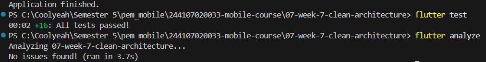

# Week 8 — Mid Project Review & Code Review

**Nama:** Fazel Priyono  
**NIM:** 244107020033  
**Kelas:** TI3D — 16  
**Project yang direview:** [`07-week-7-clean-architecture`](../07-week-7-clean-architecture) (`clean_notes_app`)

---

## 1. Status Paruh Semester

| Aspek | Status | Bukti |
|---|---|---|
| Aplikasi berjalan | ✅ Sama dengan akhir Week 7 (CRUD catatan, pencarian, tema, dirty flag) | `screenshots/note-page.png`, `screenshots/tambah-note.png` |
| `flutter analyze` | ✅ `No issues found!` | [`docs/evidence/analyze-final.txt`](docs/evidence/analyze-final.txt) |
| `dart format` | ✅ `0 changed` | [`docs/evidence/format-final.txt`](docs/evidence/format-final.txt) |
| `flutter test` | ✅ **19 test lulus** | [`docs/evidence/test-final.txt`](docs/evidence/test-final.txt) |
| CI | ✅ Workflow siap, menunggu push/PR | [`.github/workflows/ci.yml`](../.github/workflows/ci.yml) |
| Git Flow | ✅ `develop` + branch `chore/*`, `fix/*`, `docs/*` | [`docs/evidence/git-audit-before.txt`](docs/evidence/git-audit-before.txt) |
| Review | ✅ Simulasi mandiri terdokumentasi | [`docs/review-checklist.md`](docs/review-checklist.md) |
| AI Review | ✅ 2 temuan diterima + 1 ditolak dengan alasan | [`docs/ai-review-vs-keputusan.md`](docs/ai-review-vs-keputusan.md) |

> **Catatan jujur:** issue dan Pull Request GitHub belum dibuat otomatis karena `gh` CLI tidak tersedia di lingkungan ini. Branch, commit, judul issue, dan body PR sudah disiapkan di [`docs/issue-pr-map.md`](docs/issue-pr-map.md) agar tinggal disalin ke GitHub. Status di tabel ini akan berubah menjadi *Merged* setelah PR dibuat dan di-merge.

---

## 2. Peta Issue / PR

| ID | Jenis | Judul | Branch | Commit | Status |
|---|---|---|---|---|---|
| #1 | `chore` | Track `pubspec`, `analysis_options`, dan test Week 7 | `chore/1-track-project-files` | `4e551c5` | Siap dibuka sebagai PR |
| #2 | `fix` | Trim judul/isi pada `UpdateNote` + test | `fix/2-update-note-trim` | `27ae786` | Siap dibuka sebagai PR |
| #3 | `chore` | CI analyze, format, dan test | `chore/3-ci` | `27ae9dd` | Siap dibuka sebagai PR |
| #4 | `docs` | Laporan mid project review | `docs/4-week-8-report` | — | Siap dibuka sebagai PR |

Branch disusun bertingkat (*stacked*) agar PR #2–#4 tetap dapat diuji sebelum PR #1 di-merge:

```
main
└── develop
    └── chore/1-track-project-files
        └── fix/2-update-note-trim
            └── chore/3-ci
                └── docs/4-week-8-report
```

Setelah PR #1 di-merge ke `develop`, retarget PR berikutnya ke `develop`. Detail body issue/PR ada di [`docs/issue-pr-map.md`](docs/issue-pr-map.md).

---

## 3. Fitur Utama

- CRUD catatan lengkap: tambah, lihat detail, edit, hapus.
- Pencarian catatan berdasarkan judul dan isi.
- Tema terang/gelap yang persisten melalui `SharedPreferences`.
- Penanda catatan lokal (`dirty flag`) pada SQLite.
- Struktur **feature-first Clean Architecture**: `presentation → domain ← data`.
- Dependency Injection terpusat melalui Riverpod.
- Validasi domain: judul kosong ditolak; judul/isi otomatis di-`trim`.

---

## 4. Stack Teknologi

| Komponen | Teknologi |
|---|---|
| Framework | Flutter 3.47.1 / Dart 3.13.1 |
| State management & DI | `flutter_riverpod ^3.4.3` |
| Routing | `go_router ^18.0.2` |
| Database lokal | `sqflite ^2.4.4` + `sqflite_common_ffi_web ^1.2.0` |
| Key-value storage | `shared_preferences ^2.5.5` |
| Testing | `flutter_test`, `sqflite_common_ffi ^2.3.4+4` |
| CI | GitHub Actions + `subosito/flutter-action@v2` |

---

## 5. Struktur Project

Project yang direview tetap berada di folder Week 7:

```
07-week-7-clean-architecture/
├── lib/
│   ├── core/                     # failures.dart, format.dart (pure Dart)
│   └── features/
│       ├── notes/
│       │   ├── domain/           # entity, repository interface, use cases
│       │   ├── data/             # model, datasource, repository impl
│       │   └── presentation/     # providers, pages, widgets
│       └── settings/
│           ├── domain/
│           ├── data/
│           └── presentation/
├── test/                         # 19 unit/widget test
├── docs/AI_CHALLENGE.md
├── screenshots/
└── README.md
```

---

## 6. Cara Menjalankan

```bash
cd 07-week-7-clean-architecture
flutter pub get

# Folder platform sengaja tidak di-track (.gitignore).
# Jalankan sekali jika folder android/web belum ada:
flutter create . --platforms=android,web

flutter run -d chrome
```

Menjalankan verifikasi mesin:

```bash
flutter analyze
dart format --output=none --set-exit-if-changed lib test
flutter test
```

---

## 7. Hasil Pengujian

```text
$ flutter analyze
Analyzing 07-week-7-clean-architecture...
No issues found! (ran in 3.3s)

$ dart format --output=none --set-exit-if-changed lib test
Formatted 31 files (0 changed) in 0.13 seconds.

$ flutter test
00:00 +19: All tests passed!
```

Bukti lengkap:
- [`docs/evidence/analyze-final.txt`](docs/evidence/analyze-final.txt)
- [`docs/evidence/format-final.txt`](docs/evidence/format-final.txt)
- [`docs/evidence/test-final.txt`](docs/evidence/test-final.txt)
- [`docs/evidence/test-update-note.txt`](docs/evidence/test-update-note.txt)
- [`docs/evidence/sterility-checks.txt`](docs/evidence/sterility-checks.txt)



---

## 8. Ringkasan Review

Review dilakukan secara mandiri (*self-review simulation*) dengan checklist terstruktur. Temuan utama:

1. **Kebenaran:** `UpdateNote` memvalidasi judul kosong, tetapi tidak melakukan `trim` sebelum menyimpan. Diperbaiki di PR #2.
2. **Kebenaran:** Dialog tambah catatan ditutup sebelum memeriksa `result.failure`, sehingga input pengguna hilang saat validasi gagal. Dicatat sebagai issue lanjutan (belum diperbaiki agar scope PR #2 tetap satu tujuan).
3. **Arsitektur:** `dirtyCountProvider` dan `noteDetailProvider` memanggil repository langsung. **Ditolak** untuk dibungkus use case karena operasi *pass-through* tanpa logika bisnis (sesuai refleksi Week 7).
4. **Test:** `UpdateNote` belum memiliki unit test. Ditambahkan 3 test di PR #2.
5. **Keterbacaan:** Import `'../..//data/...'` memiliki garis miring ganda. Ditunda ke PR refactor terpisah (tidak mengubah perilaku).

Keputusan akhir: **Approve (simulasi)** setelah PR #1–#4 diverifikasi lokal. Detail ada di [`docs/review-checklist.md`](docs/review-checklist.md).

---

## 9. Hasil Review AI

Prompt yang dipakai sesuai codelab, dengan konteks feature-first Clean Architecture, Riverpod, GoRouter, SQLite, dan Dio. AI memberi 5 temuan; **2 temuan diterima dan diperbaiki**, **1 ditolak dengan alasan teknis**, dan 2 ditunda.

| # | Temuan | Level | Keputusan | Bukti |
|---|---|---|---|---|
| 1 | `UpdateNote` tidak `trim` judul/isi | Blocker | ✅ Diterima & diperbaiki | `test/update_note_test.dart` |
| 2 | Tidak ada unit test `UpdateNote` | Blocker | ✅ Diterima & diperbaiki | 3 test baru |
| 3 | Dialog ditutup sebelum cek failure | Blocker | ⏳ Diterima, ditunda | `notes_page.dart:118-129` |
| 4 | Bungkus operasi pass-through dengan use case | Saran | ❌ Ditolak | Refleksi Week 7 §8.2 |
| 5 | Import path garis miring ganda | Saran | ⏳ Ditunda | `notes_providers.dart:3` |

Detail prompt dan alasan keputusan: [`docs/ai-review-vs-keputusan.md`](docs/ai-review-vs-keputusan.md).

---

## 10. Refleksi

### 1. Apa beda LGTM buta dengan approve yang bertanggung jawab? Apa risikonya bagi tim?

LGTM buta hanya melihat bahwa CI hijau lalu menyetujui tanpa membaca konteks perubahan. Approve yang bertanggung jawab berarti reviewer menjalankan kode, memeriksa jalur error, dan memahami dampak arsitekturnya. Risiko LGTM buta adalah bug logika lolos ke `develop`, utang teknis menumpuk, dan tim kehilangan kepercayaan pada proses review.

### 2. Kapan komentar wajib berstatus *request changes*, dan kapan cukup saran?

*Request changes* dipakai bila ada bug kebenaran, pelanggaran dependency rule, risiko keamanan, atau test yang hilang pada perubahan berisiko. Saran dipakai untuk peningkatan keterbacaan, penamaan, atau optimasi yang tidak menghalangi merge. Dalam simulasi ini, temuan `trim` dan test masuk kategori wajib diperbaiki; import garis miring ganda cukup saran.

### 3. Bagian mana dari review AI yang Anda tolak atau sederhanakan, dan mengapa?

Saya menolak saran membungkus `getNoteById` dan `countDirty` menjadi use case terpisah. Keduanya hanya meneruskan panggilan repository tanpa validasi atau orkestrasi. Menambah use case satu baris akan menambah boilerplate dan beban kognitif tanpa nilai bisnis. Saya juga menunda temuan dialog ditutup sebelum cek failure agar PR #2 tetap fokus pada satu perubahan.

### 4. Satu hal konkret yang Anda perbaiki setelah review sejawat — apa dampaknya?

`UpdateNote` sekarang melakukan `trim` pada judul dan isi sebelum menyimpan. Dampaknya: data yang tersimpan konsisten, pencarian tidak terganggu spasi tersembunyi, dan perilaku edit sejalan dengan `AddNote`. Perbaikan ini dibuktikan oleh tiga unit test baru dan seluruh 19 test tetap hijau.

---

## 11. Batasan dan Langkah Manual

1. **Issue/PR GitHub belum dibuat.** Jalankan langkah di [`docs/issue-pr-map.md`](docs/issue-pr-map.md) setelah push branch.
2. **Screenshot CI dan halaman PR** belum dapat diambil karena PR belum ada. Setelah PR dibuka, simpan screenshot ke `screenshots/ci-green.png` dan `screenshots/pr-review.png`.
3. **Review sejawat asli** belum dilakukan. Dokumentasi ini mencatat simulasi mandiri secara transparan; bila dosen mensyaratkan reviewer eksternal, minta teman menambahkan minimal 3 komentar di PR.
4. **Nama package Week 7** masih `week5_offline_notes` (warisan Week 5). Tidak diubah pada Week 8 agar aplikasi tetap identik dengan akhir Week 7; direncanakan sebagai refactor terpisah.
