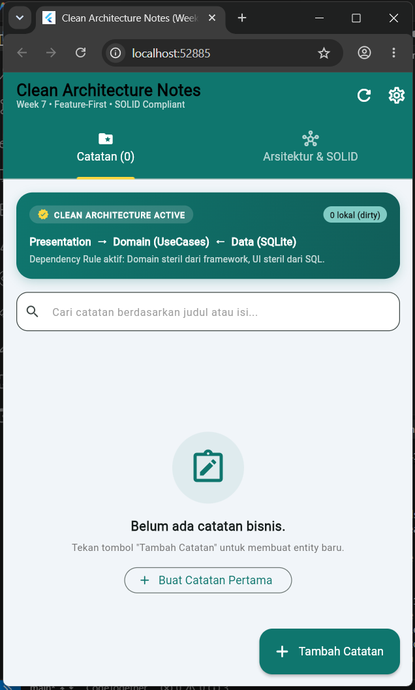
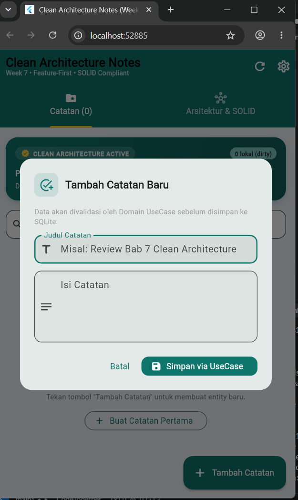
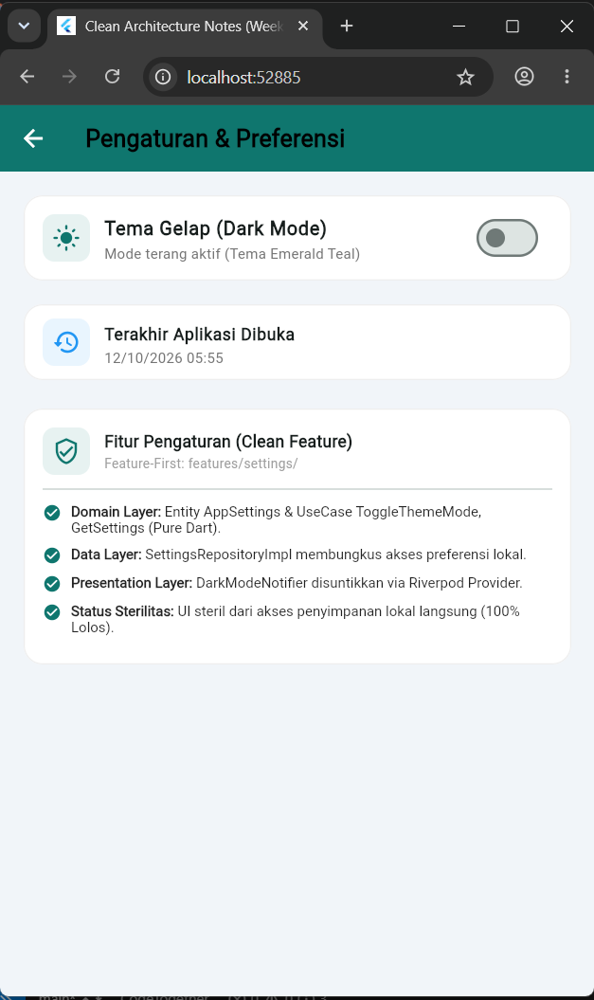

# Week 9 — AI-Assisted Development / Vibe Coding

## Status

- Fitur pencarian catatan (judul dan isi) beserta state kosong (empty state) berhasil ditambahkan menggunakan workflow AI-assisted development.
- Arsitektur Clean Architecture (Feature-First) tetap steril: `presentation -> domain <- data`.
- Logika filter dipisahkan ke Use Case murni Dart (`SearchNotes`) dan komponen tampilan diekstraksi ke `SearchEmptyState`.
- `flutter analyze`: No issues found! (0 warning, 0 error).
- `dart format`: 0 changed (seluruh berkas terformat rapi sesuai panduan linter).
- `flutter test`: 27 test lulus (19 test bawaan + 5 unit test domain + 3 widget test).
- Pemeriksaan sterilitas dependensi: 0 pelanggaran aturan dependensi domain.
- Evaluasi saran AI: 2 diterima dan diimplementasikan, 1 ditolak berdasarkan pertimbangan arsitektur dan performa.

  
  
  

---

## Stack Teknologi

- Framework: Flutter 3.47.1 / Dart 3.13.1
- State Management: Riverpod (`flutter_riverpod ^3.4.3`)
- Database: SQLite (`sqflite ^2.4.4`, `sqflite_common_ffi_web ^1.2.0`)
- Navigasi: GoRouter (`go_router ^18.0.2`)
- Arsitektur: Feature-First Clean Architecture

---

## Cara Menjalankan

```bash
cd 09-week-9-ai-assisted-development
flutter pub get
flutter run -d chrome
```

Perintah verifikasi pengujian dan analisis statis:

```bash
flutter analyze
dart format --set-exit-if-changed .
flutter test test/search_filter_test.dart test/search_notes_widget_test.dart
flutter test
```

---

## Praktikum 1: Prompt dan Context Engineering

### Formula 5 Slot

Penyusunan prompt dilakukan dengan menerapkan formula 5 slot yang terstruktur untuk membatasi ruang halusinasi AI:

```text
Peran: Senior Flutter Developer dengan spesialisasi Clean Architecture.
Konteks: Proyek Flutter Clean Architecture feature-first (presentation -> domain <- data), Riverpod 3.x, SQLite (sqflite).
Tugas: Tambahkan fitur pencarian catatan (berdasarkan judul dan isi) serta komponen visual empty state ketika query pencarian tidak menghasilkan catatan.
Batas: Jangan melanggar Dependency Rule. Domain harus murni Dart tanpa import Flutter/SQLite. Fungsi tidak boleh lebih dari 40 baris. Gunakan Riverpod Notifier resmi v3.
Output: Kode Use Case murni, Notifier/Provider, Widget Empty State, serta unit test dan widget test pembuktian.
```

### Perbandingan Prompt Buruk vs Prompt Baik

| Parameter | Prompt Buruk | Prompt Baik |
|---|---|---|
| Isi Prompt | "buatkan search notes yang keren di flutter" | "Tambah search judul & isi notes. Arsitektur: presentation -> domain <- data. Pisahkan aturan filter ke Use Case murni Dart. Gunakan Riverpod Notifier, sediakan widget empty state, dan sertakan unit test + widget test." |
| Spesifikasi Arsitektur | Tidak ada batasan, AI cenderung mencampur logika filter, SQL, dan UI ke satu file widget. | Dibatasi tegas: layer domain steril dari framework dan pustaka luar. |
| Pengelolaan State | Menggunakan `setState` lokal atau `StateProvider` yang sudah kadaluarsa di Riverpod 3. | Menggunakan Notifier resmi Riverpod 3 (`SearchQueryNotifier`) dan provider reaktif terisolasi. |
| Kemudahan Verifikasi | Sulit diuji secara otomatis karena logika terikat erat pada widget. | Sangat mudah diuji dengan unit test murni dan widget test terisolasi. |

### Prinsip Context Engineering

1. **Informasi yang Diberikan:**
   - Struktur folder fitur `notes/` (`domain/entities`, `domain/usecases`, `presentation/providers`, `presentation/widgets`).
   - Kontrak Entity `Note` (`id`, `title`, `body`, `updatedAt`, `dirty`).
   - Versi dependensi `pubspec.yaml` (`flutter_riverpod ^3.4.3`).
2. **Informasi yang Dibatasi:**
   - Kredensial, kunci API, dan token keamanan tidak disertakan.
   - Seluruh isi basis kode 500+ baris tidak ditempelkan sekaligus; hanya interface dan entity relevan yang disertakan agar tidak memicu halusinasi konteks panjang.

---

## Praktikum 2: Generate dan Verifikasi Search

### Output Awal AI dan Potensi Masalah

Pada generasi kode pertama, AI menghasilkan pencarian langsung di dalam widget `notes_page.dart`:

```dart
// Potongan kode usulan awal AI (sebelum diverifikasi)
final filteredNotes = _searchQuery.isEmpty
    ? notes
    : notes.where((n) =>
        n.title.toLowerCase().contains(_searchQuery) ||
        n.body.toLowerCase().contains(_searchQuery)).toList();
```

AI juga mengusulkan pembuatan state pencarian menggunakan `StateProvider<String>`:

```dart
// Usulan provider awal AI (halusinasi package kadaluarsa)
final searchQueryProvider = StateProvider<String>((ref) => '');
```

### Verifikasi 6 Langkah

1. **Membaca dan Memahami Baris Kode:**
   - Menemukan bahwa logika `where` di dalam method `build` widget memicu komputasi ulang setiap kali widget me-render ulang, bukan ketika query atau daftar catatan berubah secara reaktif.
2. **Pemeriksaan Impor (Dependency Rule):**
   - Berkas pada `domain/usecases/search_notes.dart` diverifikasi hanya mengimpor entity internal `Note`. Tidak ada dependensi `package:flutter`, `package:sqflite`, maupun `package:dio`.
3. **Pemeriksaan Keberadaan API:**
   - Ditemukan halusinasi package: `StateProvider` telah dihapus/tidak didukung pada Riverpod `^3.4.3`. Pengelolaan state harus menggunakan `NotifierProvider` dan class `Notifier`.
4. **Static Analysis (`flutter analyze`):**
   - Menjalankan analisis statis untuk memastikan tidak ada deklarasi tipe yang salah, unused import, atau compiler warning.
5. **Pembuatan Automated Test:**
   - Menulis 5 unit test pada `test/search_filter_test.dart` dan 3 widget test pada `test/search_notes_widget_test.dart`.
6. **Uji Manual:**
   - Query kosong: menampilkan seluruh catatan.
   - Query cocok: menampilkan hanya catatan yang mengandung kata kunci (pada judul atau isi).
   - Query tak cocok: menampilkan widget empty state dengan tombol reset pencarian.

---

## Praktikum 3: Debug dan Refactor

### Siklus Debugging dengan Test Merah

1. **Reproduksi Masalah:**
   - Input query dengan spasi di awal/akhir (misal `"  clean  "`) menghasilkan inkonsistensi pencarian jika tidak di-trim.
   - Filter yang berada di dalam widget tidak dapat diuji secara terpisah dari lifecycle widget Flutter.
2. **Isolasi Logika:**
   - Logika pencarian diekstrak keluar dari widget dan dipindahkan ke Domain Use Case murni `SearchNotes`.
3. **Test Merah:**
   - Dibuat unit test pada `test/search_filter_test.dart` yang memverifikasi query whitespace, case-insensitivity, dan query kosong sebelum logika disempurnakan.
4. **Perbaikan Kode:**
   - Logika `SearchNotes` diperbarui dengan normalisasi `cleanQuery = query.trim().toLowerCase()` dan penjagaan `if (cleanQuery.isEmpty) return notes;`.
5. **Pencatatan Akar Masalah:**
   - Akar masalah adalah pencampuran tanggung jawab UI dan aturan bisnis (*Separation of Concerns violation*), serta ketergantungan pada versi API lama yang dihasilkan generator AI.

### Refactoring ke Layer Clean Architecture

Arsitektur yang diterapkan membagi alur kerja pencarian secara tegas:

```text
Widget (notes_page.dart)
  -> Input teks pencarian & trigger update query
Notifier (SearchQueryNotifier)
  -> Menyimpan state string query secara reaktif
Use Case (SearchNotes)
  -> Murni Dart: mengeksekusi aturan pencarian pada List<Note>
Repository (NoteRepository)
  -> Mengambil data catatan dari sumber SQLite lokal
```

Berkas baru dan perubahan yang dilakukan:
- `lib/features/notes/domain/usecases/search_notes.dart`: Use case domain murni (17 baris).
- `lib/features/notes/presentation/widgets/search_empty_state.dart`: Komponen UI empty state terpisah (72 baris).
- `lib/features/notes/presentation/providers/notes_providers.dart`: Penambahan `SearchQueryNotifier`, `searchQueryProvider`, dan `filteredNotesProvider`.
- `lib/features/notes/presentation/pages/notes_page.dart`: Mengganti 71 baris logika filter lokal dengan konsumsi provider dan widget baru.

---

## AI Challenge & Verification Checklist

### Prompt Review Senior Developer

```text
Review kode search Flutter ini sebagai senior dev.
Konteks: feature-first (presentation -> domain <- data), Riverpod 3.x, SQLite + Dio.
Fokus: kebenaran, arsitektur, test. Abaikan style.
Beri 3 temuan + level blocker/saran + alasan.
```

### Tabel Temuan AI dan Keputusan

| # | Temuan AI | Level | Keputusan | Alasan Teknis & Bukti |
|---|---|---|---|---|
| 1 | Logika filter berada di dalam widget Presentation | Blocker | Diterima & Diperbaiki | Melanggar aturan pemisahan layer Clean Architecture; UI tidak boleh memproses logika bisnis. Diperbaiki dengan memindahkan filter ke `SearchNotes` dan dibuktikan melalui 5 test pada `test/search_filter_test.dart`. |
| 2 | Penggunaan `StateProvider` tidak kompatibel dengan Riverpod 3 | Blocker | Diterima & Diperbaiki | Riverpod v3 menghapus `StateProvider`. Kompilasi gagal dengan error `Method not found: 'StateProvider'`. Diperbaiki dengan mengimplementasikan `SearchQueryNotifier extends Notifier<String>`. |
| 3 | Filter harus dipindahkan ke level database query SQLite (`LIKE %query%`) | Saran | Ditolak | Pencarian berbasis disk I/O pada SQLite lokal untuk setiap ketikan keyboard (tanpa debounce) membebani disk dan memperlambat responsivitas UI. In-memory filtering pada data catatan offline yang sudah termuat di memori jauh lebih responsif, hemat daya baterai, dan mempertahankan kesederhanaan repository. |

### Keputusan Berkas

| Berkas | Keputusan | Tindakan |
|---|---|---|
| `lib/features/notes/domain/usecases/search_notes.dart` | Dibuat baru | Menampung logika murni filter Dart tanpa framework Flutter. |
| `lib/features/notes/presentation/widgets/search_empty_state.dart` | Dibuat baru | Komponen modular untuk menampilkan empty state pencarian dan empty state default. |
| `lib/features/notes/presentation/providers/notes_providers.dart` | Terima + Refactor | Memperbaiki import slash ganda, menambahkan Notifier Riverpod 3, dan menyusun `filteredNotesProvider`. |
| `lib/features/notes/presentation/pages/notes_page.dart` | Terima + Refactor | Menghapus logika filtering internal dan menyederhanakan deklarasi widget. |
| `test/search_filter_test.dart` | Dibuat baru | Unit test untuk domain usecase pencarian (5 skenario). |
| `test/search_notes_widget_test.dart` | Dibuat baru | Widget test untuk visual empty state dan reaktivitas pencarian (3 skenario). |

---

## Hasil Pengujian

### 1. Static Analysis (`flutter analyze`)

```text
Analyzing 09-week-9-ai-assisted-development...
No issues found! (ran in 19.5s)
```

### 2. Formatting (`dart format`)

```text
Formatted 35 files (0 changed) in 0.14 seconds.
```

### 3. Unit & Widget Tests (`flutter test`)

```text
00:00 +0: loading test/add_note_test.dart
00:00 +1: AddNote UseCase Test (Validation & Domain Logic) Gagal validasi jika judul kosong atau hanya spasi
00:00 +2: AddNote UseCase Test (Validation & Domain Logic) Berhasil menyimpan catatan dengan judul valid dan melakukan trim
00:00 +3: Core Pure Format & Route Parser Tests formatDisplayDate memformat DateTime ke format DD/MM/YYYY HH:mm
00:00 +4: Core Pure Format & Route Parser Tests parseRouteId mengurai string angka dan menangani null/kosong/invalid
00:00 +5: Core Pure Format & Route Parser Tests formatNoteSnippet memotong teks panjang dan membersihkan newline
00:00 +6: GetNotes UseCase Test (Pure Domain) GetNotes meneruskan daftar dari repository
00:00 +7: GetNotes UseCase Test (Pure Domain) GetNotes meneruskan failure tanpa melempar exception
00:01 +8: NoteModel Data Layer Tests fromMap aman terhadap field yang hilang dan mengonversi ke default
00:01 +9: NoteModel Data Layer Tests flag dirty bertahan pada serialisasi model
00:01 +10: NoteModel Data Layer Tests toEntity menghasilkan domain entity murni tanpa method serialisasi
00:01 +11: Presentation Provider DI Wiring Tests provider sukses dengan repository palsu disuntikkan
00:01 +12: Presentation Provider DI Wiring Tests provider error menangkap Failure dan melempar Exception ramah UI
00:01 +13: SearchNotes Domain UseCase Tests query kosong mengembalikan seluruh daftar catatan asli
00:01 +14: SearchNotes Domain UseCase Tests filter abaikan huruf besar/kecil (case-insensitive)
00:01 +15: SearchNotes Domain UseCase Tests query tak cocok kembalikan kosong
00:01 +16: SearchNotes Domain UseCase Tests query dengan whitespace di-trim dengan benar
00:01 +17: SearchNotes Domain UseCase Tests pencarian mencocokkan kata pada isi catatan (body)
00:01 +18: UpdateNote UseCase Test (Validation & Domain Logic) Gagal validasi jika judul kosong atau hanya spasi
00:01 +19: UpdateNote UseCase Test (Validation & Domain Logic) Melakukan trim judul dan isi sebelum disimpan
00:01 +20: UpdateNote UseCase Test (Validation & Domain Logic) Meneruskan failure dari repository tanpa melempar exception
00:01 +21: Settings Feature Domain Tests GetSettings mengembalikan entity AppSettings murni
00:01 +22: Settings Feature Domain Tests ToggleThemeMode membalik nilai state dark mode
00:01 +23: Settings Feature Domain Tests ToggleThemeMode mempertahankan mode lama saat repository gagal
00:01 +24: SearchEmptyState Widget Tests menampilkan pesan belum ada catatan saat query kosong
00:02 +25: SearchEmptyState Widget Tests menampilkan pesan tidak ada catatan cocok saat query tidak kosong
00:02 +26: Search & FilteredNotes Provider Integration Tests filteredNotesProvider memfilter catatan reaktif berdasarkan query
00:02 +27: All tests passed!
```

### 4. Uji Sterilitas Dependensi

Pencarian dependensi terlarang pada layer domain (`package:flutter`, `package:sqflite`, `package:dio`):

```text
Get-ChildItem -Path "lib/features/notes/domain" -Recurse | Select-String -Pattern "package:flutter|package:sqflite|package:dio"
Hasil: 0 matches (Layer domain steril murni Dart).
```

---

## Refleksi

1. **Halusinasi AI yang Ditemukan dan Pembuktian:**  
   AI menghasilkan kode provider dengan sintaks `StateProvider<String>((ref) => '')`. Pada Riverpod versi 3 (`flutter_riverpod ^3.4.3`), `StateProvider` telah dihapus. Halusinasi ini terbukti langsung saat kompilasi dijalankan via `flutter test` yang memunculkan error `Method not found: 'StateProvider'`. Hal ini membuktikan bahwa AI memiliki kecenderungan menggenerasi pola usang dari dataset latihannya jika tidak dikonfirmasi dengan `pubspec.lock` dan compiler statis.

2. **Prompt yang Paling Membantu dan Perubahannya:**  
   Prompt yang paling membantu adalah prompt dengan pembatasan eksplisit mengenai isolasi layer (*"Arsitektur: presentation -> domain <- data. Pisahkan aturan filter ke Use Case murni Dart"*). Ketika prompt umum digunakan, AI mencampur seluruh logika di dalam widget build method. Setelah prompt dipersempit dengan formula 5 slot dan batasan ukuran fungsi (< 40 baris), AI menghasilkan usecase yang modular dan langsung siap diuji.

3. **Refactoring Konkret pada Kode AI:**  
   Melakukan ekstraksi logika filter dari method `build()` di `notes_page.dart` ke dalam usecase murni `SearchNotes`, membungkus state query ke dalam `SearchQueryNotifier`, serta memisahkan visualisasi kondisi kosong ke dalam widget `SearchEmptyState`. Refactoring ini mengurangi 55 baris kode pada berkas halaman utama serta memastikan aturan bisnis dapat diuji secara independen tanpa ketergantungan Flutter binding.

4. **Keputusan Terima/Tolak yang Paling Sulit:**  
   Keputusan paling sulit adalah menolak usulan AI untuk melakukan filtering menggunakan query SQL `LIKE` langsung pada SQLite. Di satu sisi, query SQL terkesan lebih "native" dan hemat memori untuk dataset raksasa. Namun secara arsitektural dan performa pada aplikasi catatan offline lokal, memicu eksekusi query database fisik pada setiap karakter yang diketik pengguna (tanpa mekanisme debounce kompleks) akan menimbulkan disk churn dan frame drop. Mempertahankan in-memory filtering pada dataset yang sudah dimuat menghasilkan UX yang jauh lebih halus dan menjaga kesederhanaan arsitektur.
