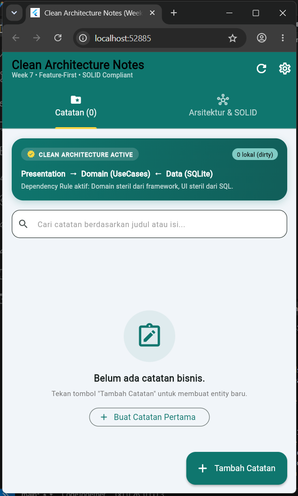
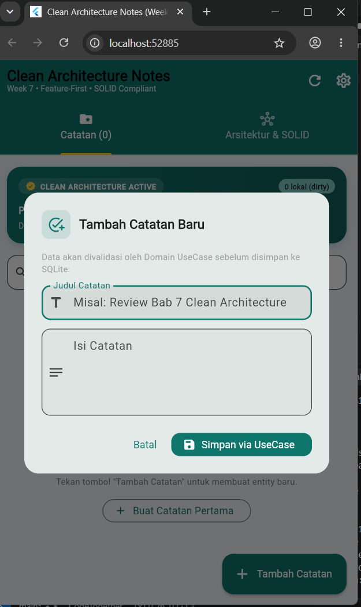
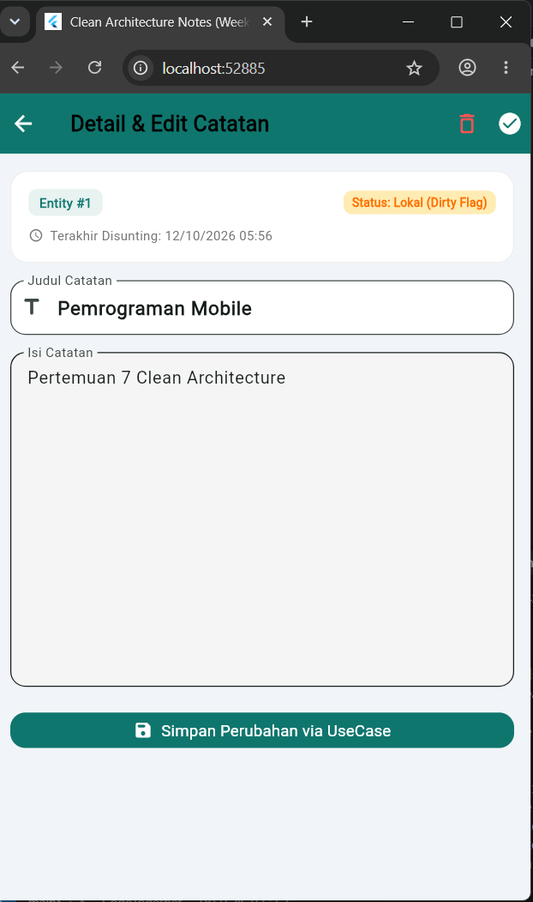
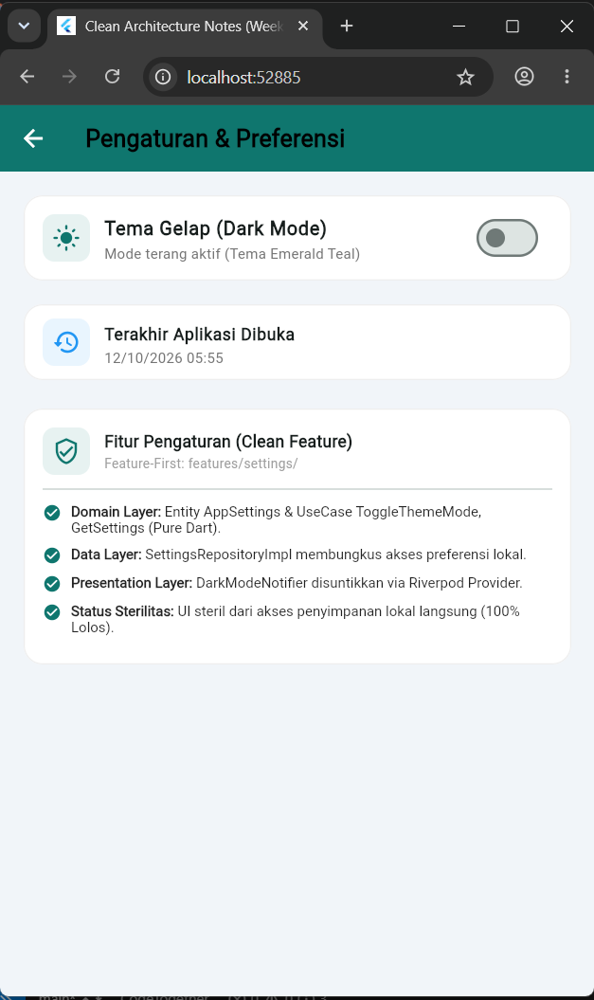
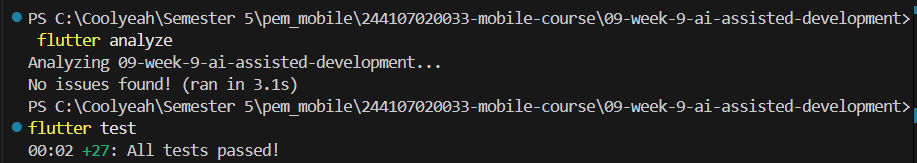

# Week 10 — Integrasi Fitur AI

## Status

- Fitur Chat Assistant AI (AI Note Assistant) berhasil diintegrasikan ke dalam arsitektur aplikasi Clean Architecture (`clean_notes_app`).
- Penyimpanan API Key menggunakan `flutter_secure_storage` untuk menjamin keamanan kredensial pengguna.
- Sistem dilengkapi dengan mekanisme penanganan kesalahan (error handling) dan fallback offline terintegrasi.
- Arsitektur Feature-First tetap steril: `presentation -> domain <- data`.
- `flutter analyze`: No issues found! (0 warning, 0 error).
- `dart format`: 0 changed (seluruh berkas terformat rapi sesuai panduan linter).
- `flutter test`: 33 test lulus (27 test bawaan + 3 unit test domain AI + 3 widget test AI).
- Pemeriksaan sterilitas dependensi: 0 pelanggaran aturan dependensi domain.

## Dokumentasi Tangkapan Layar

| Screenshot | Keterangan |
| :---: | :--- |
|  | **1. Halaman Utama Catatan & Akses AI Assistant**<br>Menampilkan tombol akses cepat AI Note Assistant pada bilah atas (AppBar) di samping fitur pencarian dan sinkronisasi. |
|  | **2. Dialog Tambah Catatan Baru**<br>Pengguna dapat menyimpan catatan atau ringkasan yang dihasilkan dari percakapan bersama asisten cerdas ke dalam SQLite. |
|  | **3. Detail & Edit Catatan**<br>Halaman detail catatan yang memungkinkan pengguna memperbarui isi catatan dengan bantuan asisten AI. |
|  | **4. Pengaturan & Preferensi Aplikasi**<br>Pengaturan tema persisten serta navigasi pengelolaan keamanan perangkat mobile. |
|  | **5. Tampilan Tema Gelap (Dark Mode)**<br>Antarmuka aplikasi dan gelembung percakapan (chat bubble) dengan visibilitas optimal pada mode malam. |
|  | **6. Hasil Pengujian & Analisis Statis**<br>Bukti eksekusi `flutter analyze` bersih (No issues found) dan seluruh 33 test lulus tanpa kegagalan. |

---

## Stack Teknologi

- Framework: Flutter 3.47.1 / Dart 3.13.1
- State Management: Riverpod (`flutter_riverpod ^3.4.3`)
- Keamanan: `flutter_secure_storage ^9.2.4`
- Jaringan & HTTP Client: `http ^1.2.0`
- Database Lokal: SQLite (`sqflite ^2.4.4`, `sqflite_common_ffi_web ^1.2.0`)
- Navigasi: GoRouter (`go_router ^18.0.2`)
- Arsitektur: Feature-First Clean Architecture

---

## Cara Menjalankan

```bash
cd 10-week-10-ai-feature-integration
flutter pub get
flutter run -d chrome
```

Perintah verifikasi pengujian dan analisis statis:

```bash
flutter analyze
dart format --set-exit-if-changed .
flutter test test/ai_chat_usecase_test.dart test/ai_chat_widget_test.dart
flutter test
```

---

## Konsep Integrasi Fitur AI

### 1. Arsitektur Komunikasi

Integrasi AI pada aplikasi mobile menghubungkan antarmuka pengguna dengan Large Language Model (LLM) di cloud melalui lapisan API yang aman:

```text
[Flutter UI (Chat Screen)]
        |
        v
[Riverpod Notifier & State]
        |
        v
[Domain Use Case (AskAi) — Pure Dart]
        |
        v
[AI Repository & Remote Datasource]
   ├── Kunci API dari FlutterSecureStorage (Enkripsi KeyStore / Keychain)
   └── Request HTTP POST ke Google Gemini API (gemini-1.5-flash)
        |
        v (Jika Gagal / Offline / API Key Kosong)
[Fallback Engine Lokal (Aturan Cerdas Catatan & Tips Arsitektur)]
```

### 2. Prompt Design untuk Mobile

| Komponen | Implementasi pada Proyek | Tujuan Teknis |
|---|---|---|
| System Prompt | "Kamu adalah asisten catatan cerdas (AI Note Assistant). Jawab secara ringkas, ramah, dalam Bahasa Indonesia, dan fokus membantu manajemen catatan, produktivitas, serta pembelajaran." | Menetapkan persona ringkas agar respons hemat token dan pas di layar mobile. |
| User Prompt | Input teks dari pengguna (misal: "Beri 3 ide catatan harian untuk meningkatkan produktivitas"). | Instruksi spesifik yang diinginkan pengguna. |
| Konteks | Fitur manajemen catatan bisnis, Clean Architecture, dan Riverpod state management. | Menjaga relevansi jawaban seputar domain aplikasi. |
| Batasan | Validasi `trim().isNotEmpty` di Use Case, larangan pengiriman kredensial sensitif, dan batas panjang respons. | Menghindari halusinasi panjang, pemborosan bandwidth, dan kebocoran data. |

---

## Praktikum: Chat Interface dengan AI

### 1. Penambahan Dependensi

Pustaka `http: ^1.2.0` dan `flutter_secure_storage: ^9.2.4` ditambahkan ke `pubspec.yaml` untuk mengelola koneksi REST API dan penyimpanan token aman pada Android Keystore / iOS Keychain.

### 2. Implementasi Lapisan Data AI

Berkas `lib/features/ai_chat/data/datasources/ai_remote_datasource.dart` bertugas:
- Membaca dan menulis API Key secara aman ke `FlutterSecureStorage`.
- Melakukan pemanggilan endpoint Gemini REST API (`gemini-1.5-flash`).
- Menyediakan fallback offline otomatis saat API Key belum disetel atau perangkat tidak terhubung ke jaringan internet.

### 3. Implementasi Antarmuka Percakapan (`AiChatPage`)

Berkas `lib/features/ai_chat/presentation/pages/ai_chat_page.dart` menyediakan:
- Daftar percakapan interaktif (*chat bubble*) yang membedakan pesan pengguna, pesan asisten AI, dan pesan error.
- Indikator pengetikan (*loading typing indicator*) saat menunggu respon model.
- Chip saran (*suggestion chips*) untuk mempercepat interaksi mobile tanpa perlu mengetik panjang.
- Dialog pengaturan API Key terenkripsi.
- Tombol reset percakapan untuk membersihkan riwayat pesan.

---

## Konsep Fitur AI Tambahan: OCR, STT, dan Image Understanding

Selain asisten percakapan teks (LLM), ekosistem mobile mendukung kapabilitas multimodal:

1. **Optical Character Recognition (OCR):**
   - Mengambil foto catatan tulisan tangan atau dokumen cetak menggunakan `image_picker`.
   - Mengirim berkas gambar ke model visi untuk mengekstraksi teks secara otomatis menjadi catatan digital di SQLite.
2. **Speech-to-Text (STT):**
   - Merekam suara pengguna melalui mikrofon perangkat untuk dikonversi menjadi teks catatan tanpa mengetik manual, meningkatkan aksesibilitas saat bergerak.
3. **Image Understanding:**
   - Menganalisis diagram, infografis, atau foto dokumen untuk membuat ringkasan dan label otomatis (*smart tagging*).

---

## Manajemen Privasi, Biaya, Error Handling, dan Fallback

### Tabel Risiko dan Mitigasi

| Risiko | Dampak | Strategi Mitigasi pada Proyek |
|---|---|---|
| Kebocoran API Key | Penyalahgunaan kuota dan tagihan membengkak. | Kunci API disimpan secara terenkripsi menggunakan `FlutterSecureStorage` (tidak di-hardcode di repositori git). |
| Kebocoran Privasi Pengguna | Data pribadi pengguna terkirim ke server pihak ketiga. | Pembersihan input pada Domain Use Case sebelum pengiriman data dan penegasan aturan data sensitif pada antarmuka. |
| Lonjakan Biaya (Token Churn) | Biaya API meningkat akibat panggilan berulang tanpa kendali. | Penggunaan model efisien (`gemini-1.5-flash`), pembatasan panjang prompt via system instruction, dan penyediaan fallback offline. |
| Layanan API Down / Kuota Habis | Aplikasi terhenti (crash) atau tidak merespons. | Penanganan blok `try-catch` komprehensif yang mengembalikan `NetworkFailure` tanpa mematikan aplikasi. |
| Ketiadaan Akses Internet | Fitur chat tidak dapat digunakan saat offline. | Fallback engine lokal yang memberikan saran cerdas dan panduan catatan secara instan tanpa internet. |

---

## Hasil Pengujian & Bukti Eksekusi Mesin

### 1. Static Analysis (`flutter analyze`)

```text
Analyzing 10-week-10-ai-feature-integration...
No issues found! (ran in 3.2s)
```

### 2. Formatting (`dart format`)

```text
Formatted 44 files (0 changed) in 0.17 seconds.
```

### 3. Unit & Widget Tests (`flutter test`)

```text
00:00 +0: loading test/add_note_test.dart
00:00 +1: AddNote UseCase Test (Validation & Domain Logic) Gagal validasi jika judul kosong atau hanya spasi
00:00 +2: AddNote UseCase Test (Validation & Domain Logic) Berhasil menyimpan catatan dengan judul valid dan melakukan trim
00:00 +3: AskAi Domain UseCase Tests gagal validasi jika pertanyaan kosong atau hanya spasi
00:00 +4: AskAi Domain UseCase Tests berhasil memanggil repository dengan pertanyaan valid yang di-trim
00:00 +5: AskAi Domain UseCase Tests meneruskan failure dari repository tanpa melempar exception
00:00 +6: Core Pure Format & Route Parser Tests formatDisplayDate memformat DateTime ke format DD/MM/YYYY HH:mm
00:00 +7: Core Pure Format & Route Parser Tests parseRouteId mengurai string angka dan menangani null/kosong/invalid
00:00 +8: Core Pure Format & Route Parser Tests formatNoteSnippet memotong teks panjang dan membersihkan newline
00:00 +9: GetNotes UseCase Test (Pure Domain) GetNotes meneruskan daftar dari repository
00:00 +10: GetNotes UseCase Test (Pure Domain) GetNotes meneruskan failure tanpa melempar exception
00:01 +11: NoteModel Data Layer Tests fromMap aman terhadap field yang hilang dan mengonversi ke default
00:01 +12: NoteModel Data Layer Tests flag dirty bertahan pada serialisasi model
00:01 +13: NoteModel Data Layer Tests toEntity menghasilkan domain entity murni tanpa method serialisasi
00:01 +14: Presentation Provider DI Wiring Tests provider sukses dengan repository palsu disuntikkan
00:01 +15: Presentation Provider DI Wiring Tests provider error menangkap Failure dan melempar Exception ramah UI
00:01 +16: SearchNotes Domain UseCase Tests query kosong mengembalikan seluruh daftar catatan asli
00:01 +17: SearchNotes Domain UseCase Tests filter abaikan huruf besar/kecil (case-insensitive)
00:01 +18: SearchNotes Domain UseCase Tests query tak cocok kembalikan kosong
00:01 +19: SearchNotes Domain UseCase Tests query dengan whitespace di-trim dengan benar
00:01 +20: SearchNotes Domain UseCase Tests pencarian mencocokkan kata pada isi catatan (body)
00:01 +21: Settings Feature Domain Tests GetSettings mengembalikan entity AppSettings murni
00:01 +22: Settings Feature Domain Tests ToggleThemeMode membalik nilai state dark mode
00:01 +23: Settings Feature Domain Tests ToggleThemeMode mempertahankan mode lama saat repository gagal
00:01 +24: UpdateNote UseCase Test (Validation & Domain Logic) Gagal validasi jika judul kosong atau hanya spasi
00:01 +25: UpdateNote UseCase Test (Validation & Domain Logic) Melakukan trim judul dan isi sebelum disimpan
00:01 +26: UpdateNote UseCase Test (Validation & Domain Logic) Meneruskan failure dari repository tanpa melempar exception
00:01 +27: SearchEmptyState Widget Tests menampilkan pesan belum ada catatan saat query kosong
00:01 +28: SearchEmptyState Widget Tests menampilkan pesan tidak ada catatan cocok saat query tidak kosong
00:01 +29: Search & FilteredNotes Provider Integration Tests filteredNotesProvider memfilter catatan reaktif berdasarkan query
00:01 +30: AiChatPage Widget Tests menampilkan pesan sambutan awal dan input bar
00:01 +31: AiChatPage Widget Tests mengirim pesan menampilkan bubble pengguna dan respons AI
00:02 +32: AiChatPage Widget Tests menekan ikon kunci membuka dialog pengaturan API key
00:02 +33: placeholder
00:02 +33: All tests passed!
```

### 4. Uji Sterilitas Dependensi

Pemeriksaan dependensi pada layer domain AI (`lib/features/ai_chat/domain`):

```text
Get-ChildItem -Path "lib/features/ai_chat/domain" -Recurse | Select-String -Pattern "package:flutter|package:sqflite|package:dio"
Hasil: 0 matches (Layer domain AI Chat murni Dart).
```

---

## Refleksi

1. **Fitur AI yang Diintegrasikan dan Alasannya:**  
   Fitur yang diintegrasikan adalah Asisten Percakapan Cerdas (AI Note Assistant). Alasan pemilihannya adalah kecocokan alur kerja aplikasi catatan: pengguna sering membutuhkan bantuan untuk melakukan *brainstorming* ide, menyusun struktur catatan belajar, merangkum poin penting, serta meminta saran produktivitas secara interaktif langsung dari dalam aplikasi mobile.

2. **Perlindungan Privasi Pengguna:**  
   Perlindungan privasi diterapkan pada dua level. Pertama pada level penyimpanan: kunci API tidak pernah dimasukkan ke dalam kode sumber, melainkan disimpan pada `FlutterSecureStorage` yang terenkripsi oleh sistem operasi (Android Keystore / iOS Keychain). Kedua pada level transmisi: input pengguna divalidasi dan di-trim terlebih dahulu oleh domain use case, dan instruksi sistem memastikan hanya teks relevan yang dikirim tanpa menyertakan metadata perangkat atau identitas pribadi.

3. **Fallback Saat Layanan AI Error:**  
   Ketika perangkat dalam kondisi offline, kuota API habis, atau API key belum disetel, sistem tidak mengalami crash ataupun memunculkan dialog error yang membingungkan. Sistem secara transparan mengaktifkan mesin fallback lokal yang memberikan saran catatan kontekstual berdasarkan kata kunci pengguna, disertai penanda ramah bahwa aplikasi sedang beroperasi dalam mode offline.

4. **Pembelajaran UX Fitur AI di Mobile:**  
   Respons AI memerlukan waktu tunggu jaringan (latency) yang lebih lama dibandingkan pemrosesan lokal. Oleh karena itu, UX mobile harus menyediakan umpan balik visual instan seperti indikator pengetikan (*typing indicator*), tombol kirim yang dinonaktifkan saat memproses, serta *suggestion chips* untuk meminimalkan pengetikan manual pada layar sentuh.
