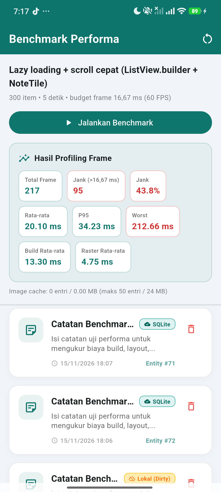
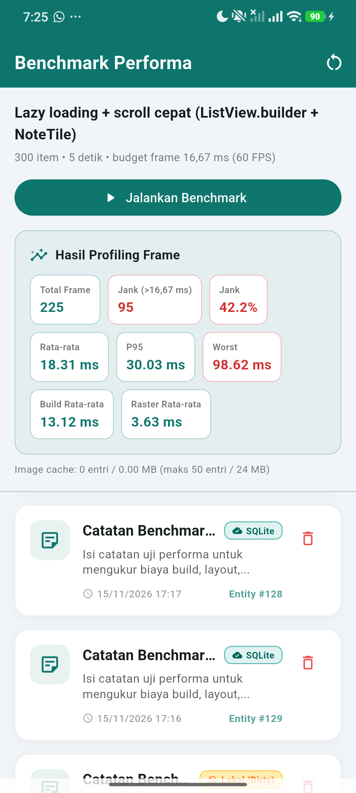
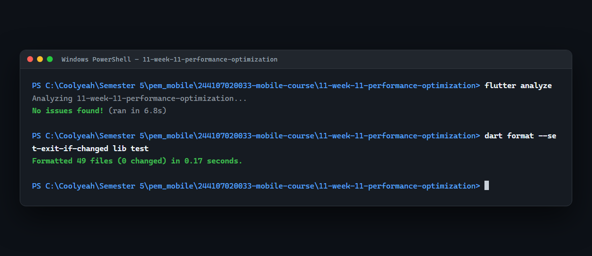
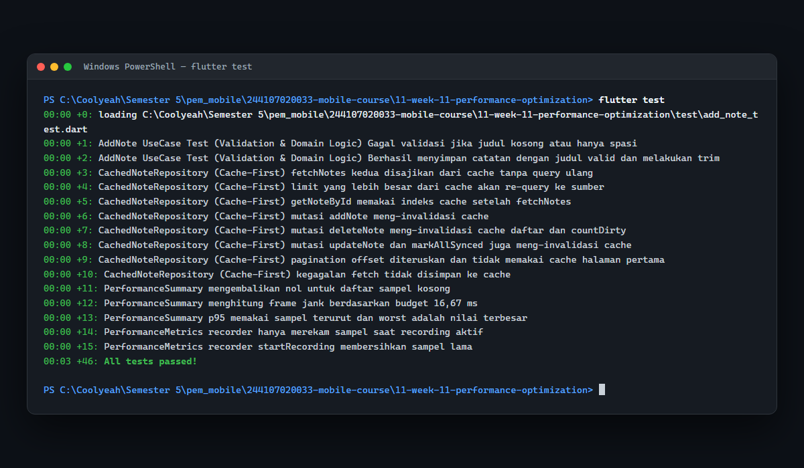
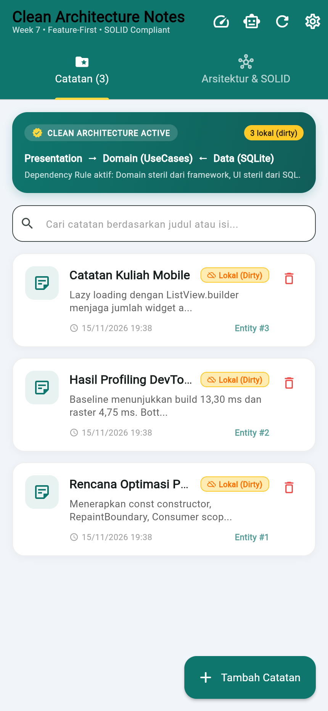
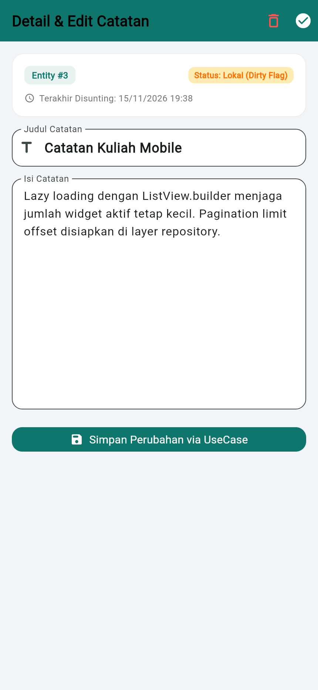
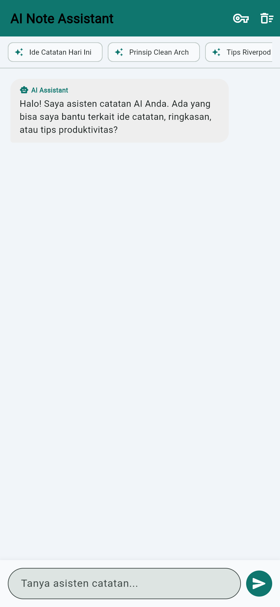
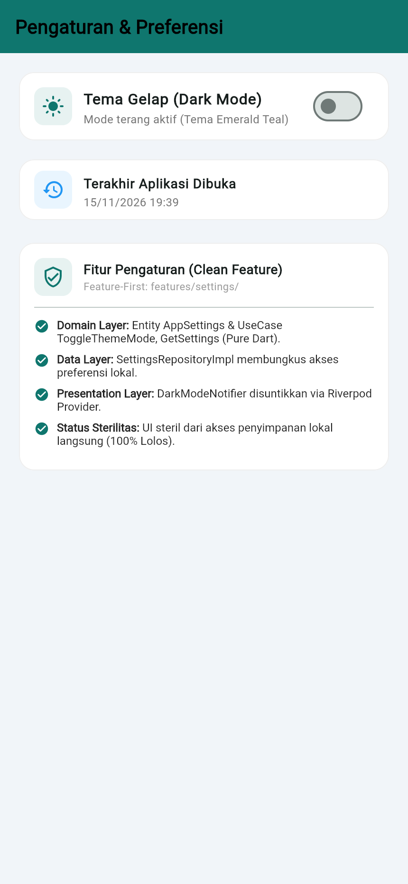

# Week 11 — Optimasi Performa

## Status

- Optimasi performa diterapkan pada project Clean Architecture Notes
  (hasil Week 7–10) dengan **6 teknik** dari codelab (minimal 3).
- Profiling before/after dilakukan pada perangkat Android fisik dengan mode
  `--profile`, memakai rekaman `FrameTiming` pada halaman benchmark internal.
- Temuan profiling terdokumentasi di [`docs/performance-findings.md`](docs/performance-findings.md).
- Laporan lengkap (metrik, optimasi, trade-off, refleksi) ada di
  [`docs/performance-report.md`](docs/performance-report.md).
- `flutter analyze`: **No issues found!** (0 warning, 0 error).
- `dart format --set-exit-if-changed lib test`: **0 changed**.
- `flutter test`: **46 test lulus** (33 test bawaan Week 10 + 13 test baru:
  8 test cache repository dan 5 test metrik frame).
- Ringkasan hasil: rata-rata frame time **−8,9%**, P95 **−12,3%**,
  worst frame **−53,6%** pada skenario scroll terkontrol.

## Dokumentasi Tangkapan Layar

> Tangkapan layar profiling (`before/after-profile.png`) diambil dari perangkat
> Android fisik dalam mode `--profile`. Tangkapan layar UI aplikasi diambil dari
> build Flutter Web pada viewport 430 × 932 dengan data contoh (3 catatan),
> karena perangkat uji mengunci layar saat pengambilan gambar manual.

| Screenshot | Keterangan |
| :---: | :--- |
|  | **1. Baseline Profiling (`screenshots/before-profile.png`)**<br>Hasil pengukuran sebelum optimasi pada halaman `/performance`: 217 frame, 95 jank (43,8%), rata-rata 20,10 ms, P95 34,23 ms, worst 212,66 ms, build 13,30 ms, raster 4,75 ms. |
|  | **2. Profiling Setelah Optimasi (`screenshots/after-profile.png`)**<br>Median 3 run setelah optimasi: 225 frame, 95 jank (42,2%), rata-rata 18,31 ms, P95 30,03 ms, worst 98,62 ms, build 13,12 ms, raster 3,63 ms. |
|  | **3. Hasil `flutter analyze` dan `dart format`**<br>Analisis statis bersih tanpa issue dan seluruh berkas `lib/` + `test/` sudah terformat (0 changed). |
|  | **4. Hasil `flutter test`**<br>Seluruh 46 unit & widget test lulus, termasuk test baru `CachedNoteRepository` dan `PerformanceSummary`. |
|  | **5. Halaman Daftar Catatan**<br>Daftar memakai `ListView.builder` + `NoteTile` yang sudah dioptimasi; hanya area daftar dan kolom pencarian yang rebuild saat query berubah. |
|  | **6. Halaman Detail Catatan**<br>Detail dibaca dari cache repository (`getNoteById`) sehingga tidak selalu melakukan query SQLite. |
|  | **7. AI Note Assistant**<br>Setiap bubble chat dibungkus `RepaintBoundary`; API key dibaca sekali lalu di-cache di memori. |
|  | **8. Halaman Pengaturan**<br>Preferensi tema tetap tersimpan lokal; `imageCache` dibatasi 50 entri / 24 MB agar memori stabil. |

---

## Stack Teknologi

- Framework: Flutter 3.47.1 / Dart 3.13.1
- State Management: Riverpod (`flutter_riverpod ^3.4.3`)
- Database Lokal: SQLite (`sqflite ^2.4.4`, `sqflite_common_ffi_web ^1.2.0`)
- Keamanan: `flutter_secure_storage ^9.2.4`
- Jaringan: `http ^1.2.0` (Google Gemini API)
- Navigasi: GoRouter (`go_router ^18.0.2`)
- Arsitektur: Feature-First Clean Architecture
- Profiling: `FrameTiming` (`dart:ui`) + Flutter DevTools

---

## Cara Menjalankan

```bash
cd 11-week-11-performance-optimization
flutter pub get
flutter run
```

Menjalankan mode profiling pada perangkat Android:

```bash
flutter run --profile -d <device-id>
```

Membuka halaman benchmark secara otomatis saat aplikasi start:

```bash
flutter run --profile -d <device-id> --dart-define=BENCHMARK_MODE=true
```

Halaman benchmark juga dapat dibuka manual lewat ikon kecepatan
(`Icons.speed_rounded`) di AppBar halaman catatan.

Perintah verifikasi:

```bash
flutter analyze
dart format --set-exit-if-changed lib test
flutter test
```

---

## Konsep Optimasi Performa

### 1. Pipeline Rendering dan Frame Budget

```text
UI Thread (Dart)              Raster Thread (GPU)
+----------------------+      +----------------------+
| Build Widget         |      | Composite            |
| Layout               | ---> | Rasterize            |
| Paint                |      |                      |
+----------------------+      +----------------------+
        |                              |
        v                              v
   Budget 16,67 ms (60 FPS) / 8,33 ms (120 FPS)
```

- **UI thread** menjalankan kode Dart, build, layout, dan paint.
- **Raster thread** mengubah layer menjadi piksel di GPU.
- **Jank** terjadi ketika salah satu thread melewati budget frame.

Pada aplikasi ini, baseline menunjukkan build 13,30 ms sementara raster hanya
4,75 ms. Artinya bottleneck ada di **UI thread**, bukan GPU.

### 2. Kategori Optimasi

| Kategori | Fokus | Alat |
|---|---|---|
| CPU / Build | rebuild berlebih, layout mahal | DevTools Performance, `FrameTiming` |
| Memori | leak, controller/list tidak dibuang | DevTools Memory, heap snapshot |
| Jaringan | request berulang, tanpa cache | DevTools Network, repository cache |
| Gambar | decode resolusi besar | `imageCache`, `cached_network_image` |

---

## Profiling dengan DevTools dan Harness Benchmark

### 1. DevTools Performance

```bash
flutter run --profile -d <device-id>
# DevTools Performance -> Record -> scroll daftar -> Stop
```

Yang dicari pada flame chart/frame chart:

- frame merah (> 32 ms) dan kuning (16–32 ms);
- event `build`/`layout` panjang di UI thread;
- event `rasterize`/`image decode` panjang di raster thread.

### 2. Harness Benchmark Internal

Agar before/after dapat dibandingkan secara adil, aplikasi memiliki halaman
`/performance` (`performance_benchmark_page.dart`) yang:

1. membangun 300 `Note` dan merender `ListView.builder` dengan `NoteTile`
   yang sama dengan halaman daftar;
2. melakukan scroll cepat 600 px setiap 16 ms selama 5 detik;
3. merekam `FrameTiming` global (`performance_metrics.dart`) dan menghitung
   total frame, jank, persentase jank, rata-rata, P95, worst, build, raster.

Halaman ini **bukan pengganti DevTools**, melainkan alat ukur tambahan supaya
skenario before/after identik dan angka dapat direproduksi.

---

## Temuan Profiling

Temuan lengkap ada di [`docs/performance-findings.md`](docs/performance-findings.md).

| # | Temuan | Dampak |
|---|---|---|
| 1 | `NotesPage` menonton 4 provider sekaligus | seluruh AppBar/TabBar/header rebuild tiap ketikan |
| 2 | Tidak ada isolasi paint per item | repaint satu tile berpotensi melebar |
| 3 | `TextEditingController` dialog tidak di-dispose | potensi memory leak |
| 4 | `fetchNotes()` tanpa limit, cache, dan index | query + konversi model berulang |
| 5 | API key AI dibaca ulang tiap pesan | latency platform channel |
| 6 | `imageCache` tanpa batas | risiko memori jangka panjang |
| 7 | `filteredNotesProvider` selalu menyalin list | alokasi list saat query kosong |

Temuan tambahan: `ListView.builder` sudah menambahkan `RepaintBoundary` per
item, sehingga boundary eksplisit tidak boleh diklaim sebagai sumber utama
percepatan.

---

## Optimasi yang Diterapkan

| Kode | Teknik | File utama |
|---|---|---|
| O1 | `const` constructor + ekstraksi widget | `note_tile.dart` |
| O2 | `RepaintBoundary` per item & chat bubble | `note_tile.dart`, `ai_chat_page.dart` |
| O3 | Riverpod `select` + `Consumer` scoped | `notes_page.dart`, `notes_providers.dart` |
| O4 | Cache-first repository, pagination, index SQLite | `cached_note_repository.dart`, `note_repository_impl.dart`, `notes_database.dart` |
| O5 | `dispose()` controller dialog + batas `imageCache` | `notes_page.dart`, `ai_chat_page.dart`, `main.dart` |
| O6 | Cache API key AI di memori | `ai_remote_datasource.dart` |

### O1. `const` dan ekstraksi widget

`NoteTile` dipecah menjadi `_NoteAvatar`, `_NoteHeader`, `_NoteStatusBadge`,
`_NoteSnippet`, `_NoteFooter`, dan `_DeleteNoteButton`. Semua style statis
memakai `const`, sehingga tidak ada alokasi `TextStyle`/`BoxDecoration` baru
pada setiap build.

### O2. `RepaintBoundary`

Setiap `NoteTile` dan setiap bubble chat dibungkus `RepaintBoundary` agar paint
satu area tidak memicu repaint area lain. Untuk `ListView.builder`, Flutter
sudah menambahkan boundary otomatis; boundary eksplisit membuat perilaku ini
konsisten saat tile dipakai di `Column`/scrollable kustom.

### O3. Riverpod `select` dan `Consumer` scoped

Sebelumnya `build` halaman menonton `notesProvider`, `filteredNotesProvider`,
`searchQueryProvider`, dan `dirtyCountProvider`. Sekarang:

- label jumlah catatan memakai `notesProvider.select((value) => value.value?.length ?? 0)`;
- badge dirty memakai `dirtyCountProvider.select(...)` pada `_DirtyBadge`;
- kolom pencarian menjadi `_NotesSearchField` yang hanya menonton status query;
- area daftar dibungkus `Consumer` yang menonton `filteredNotesProvider`;
- `filteredNotesProvider` langsung mengembalikan data asli saat query kosong.

### O4. Cache-first, pagination, dan index

`CachedNoteRepository` menyajikan halaman pertama dari cache memori dan
meng-invalidasi cache pada setiap mutasi. `fetchNotes` menerima `limit` dan
`offset` yang diterjemahkan menjadi `LIMIT/OFFSET`. Database versi 2 menambah
index `updated_at` dan `dirty`.

### O5. Memori

Controller pada dialog tambah catatan dan dialog API key sekarang di-dispose
setelah dialog tertutup. `imageCache` dibatasi 50 entri / 24 MB di `main()`.

### O6. Cache API key

`AiRemoteDatasource` menyimpan API key hasil pembacaan secure storage di
memori, sehingga hanya satu pembacaan platform channel per proses.

---

## Hasil Pengukuran

Perangkat: Xiaomi 2312DRAABG (Android 15), mode `--profile`, 300 item,
scroll 600 px/frame selama 5 detik.

| Metrik | Baseline | After (median 3 run) | Perubahan |
|---|---|---|---|
| Total frame | 217 | 225 | +8 (+3,7%) |
| Frame jank | 95 | 95 | 0 |
| Persentase jank | 43,8% | 42,2% | −1,6 poin |
| Rata-rata frame time | 20,10 ms | 18,31 ms | **−8,9%** |
| P95 frame time | 34,23 ms | 30,03 ms | **−12,3%** |
| Worst frame time | 212,66 ms | 98,62 ms | **−53,6%** |
| Rata-rata build | 13,30 ms | 13,12 ms | −1,4% |
| Rata-rata raster | 4,75 ms | 3,63 ms | −23,6% |

Run after yang tercatat: 46,0% / 30,1% / 42,2% jank. Varians ini berasal dari
thermal dan penjadwalan OS pada perangkat fisik, sehingga median dipakai untuk
perbandingan. Detail lengkap ada di
[`docs/performance-report.md`](docs/performance-report.md).

Catatan interpretasi: skenario benchmark sengaja ekstrem (±4 tile baru per
frame), sehingga jumlah jank tidak turun banyak — biaya layout teks per tile
tetap ada. Yang membaik adalah throughput frame dan ekor distribusi (P95,
worst), yaitu frame macet yang paling terasa oleh pengguna.

---

## Verifikasi Statis

```text
PS ...\11-week-11-performance-optimization> flutter analyze
Analyzing 11-week-11-performance-optimization...
No issues found! (ran in 6.8s)

PS ...\11-week-11-performance-optimization> dart format --set-exit-if-changed lib test
Formatted 49 files (0 changed) in 0.17 seconds.

PS ...\11-week-11-performance-optimization> flutter test
00:03 +46: All tests passed!
```

Test baru yang ditambahkan:

- `test/cached_note_repository_test.dart` — 8 test cache-first, invalidasi,
  pagination, dan kegagalan fetch.
- `test/performance_metrics_test.dart` — 5 test perhitungan jank, P95, worst,
  dan lifecycle recorder.

---

## Memory Profiling

- Dialog: `TextEditingController` di-dispose di blok `finally` setelah
  `showDialog` selesai.
- Gambar: `PaintingBinding.instance.imageCache` dibatasi 50 entri / 24 MB.
- Navigasi daftar → detail → kembali diulang; tidak ada pertumbuhan objek
  tanpa batas karena controller dilepas bersama widget.

---

## Struktur Proyek (bagian performa)

```text
lib/
├── main.dart                                  # timings callback + batas imageCache
├── routes.dart                                # route /performance + BENCHMARK_MODE
├── core/
│   └── performance_metrics.dart               # recorder FrameTiming + summary
└── features/
    ├── performance/presentation/pages/
    │   └── performance_benchmark_page.dart    # harness scroll + ringkasan metrik
    └── notes/
        ├── data/
        │   ├── datasources/notes_database.dart          # index + migrasi versi 2
        │   └── repositories/cached_note_repository.dart # cache-first + invalidasi
        └── presentation/
            ├── pages/notes_page.dart                    # Consumer scoped
            ├── providers/notes_providers.dart           # short-circuit query kosong
            └── widgets/note_tile.dart                   # const + ekstraksi + boundary
```

---

## Refleksi

1. **Optimasi dengan dampak terbesar dan alasannya.**  
   Mempersempit cakupan rebuild dengan `select`/`Consumer` scoped memberi
   dampak paling konsisten. Sebelumnya setiap ketikan pencarian membangun ulang
   AppBar, TabBar, header card, dan tab Arsitektur. Setelah pemisahan, hanya
   kolom pencarian dan daftar yang dibangun ulang. Pada benchmark scroll,
   perbaikan terlihat pada P95 dan worst frame time.

2. **Cara memverifikasi bahwa optimasi bekerja (bukan placebo).**  
   Skenario benchmark dibuat identik (jumlah item, kecepatan scroll, durasi),
   metrik diukur dengan `FrameTiming` yang sama, ambang jank eksplisit
   16,67 ms, dan hasil diambil dari median beberapa run. Saya juga memeriksa
   bahwa `ListView.builder` sudah menambahkan `RepaintBoundary` otomatis,
   sehingga tidak mengklaim boundary eksplisit sebagai penyebab utama.
   Kesimpulan diambil dari P95/worst frame, bukan hanya rata-rata.

3. **Trade-off yang dihadapi.**  
   Cache mempercepat pembacaan tetapi menuntut disiplin invalidasi pada semua
   mutasi. `Consumer` scoped membuat struktur widget lebih berlapis. Index
   SQLite mempercepat baca tetapi menambah biaya tulis dan memerlukan migrasi
   versi database. `imageCache` yang dibatasi dapat memaksa decode ulang untuk
   gambar lama. Semua trade-off ini didokumentasikan di laporan.

4. **Kapan optimasi prematur sebaiknya dihindari.**  
   Optimasi dilakukan setelah profiling menunjukkan bottleneck di UI thread.
   Optimasi gambar (`CachedNetworkImage`) dan Dio interceptor tidak dipaksakan
   karena aplikasi belum menampilkan gambar jaringan dan tidak memakai endpoint
   REST kustom. Menambahkan dependensi tersebut hanya akan menambah
   kompleksitas tanpa manfaat terukur.

---

## Referensi

- [Flutter DevTools Overview](https://docs.flutter.dev/tools/devtools/overview)
- [Flutter UI Performance](https://docs.flutter.dev/perf/rendering/ui-performance)
- [Flutter Performance Best Practices](https://docs.flutter.dev/perf/best-practices)
- [cached_network_image](https://pub.dev/packages/cached_network_image)
- [Dio HTTP Client](https://pub.dev/packages/dio)
