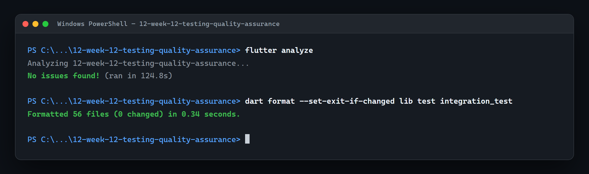
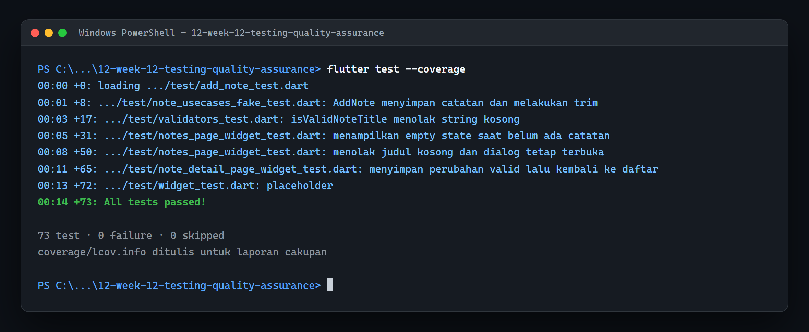
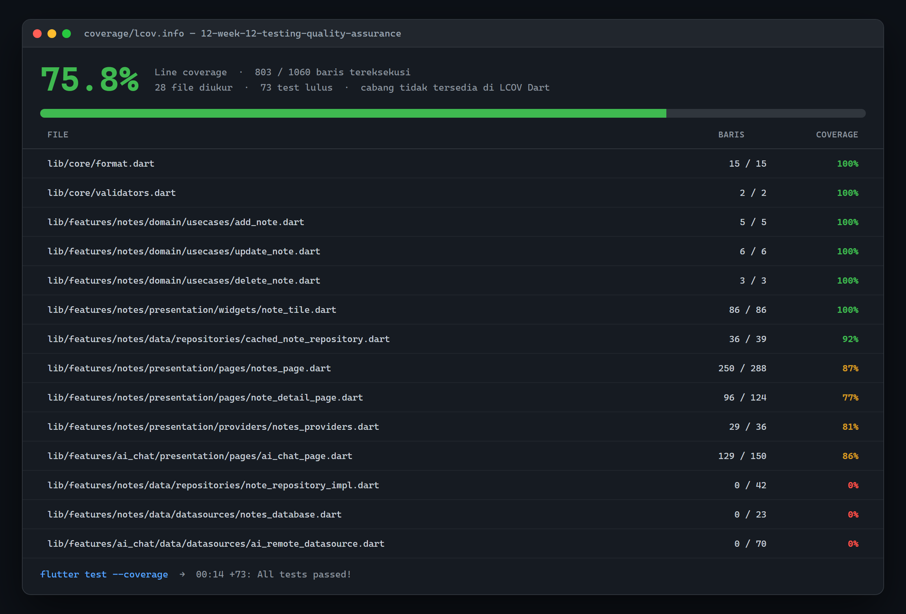
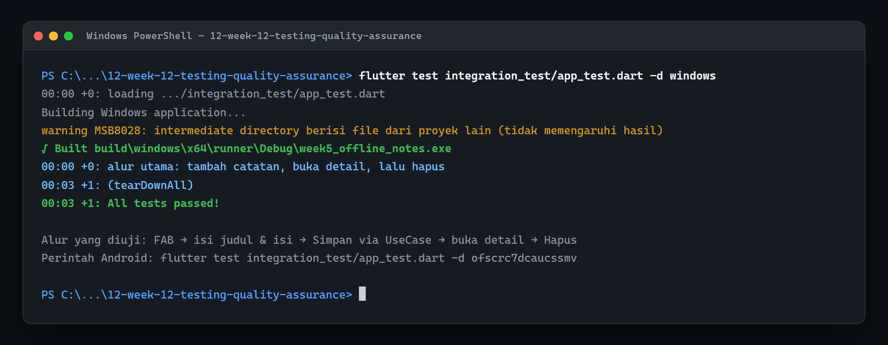
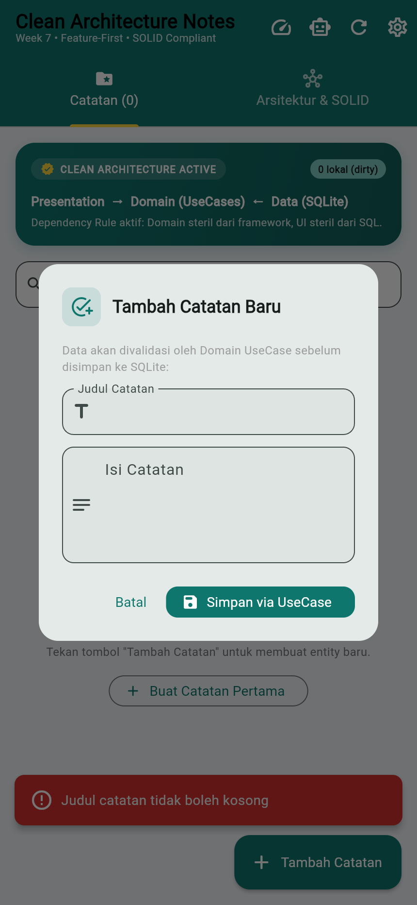
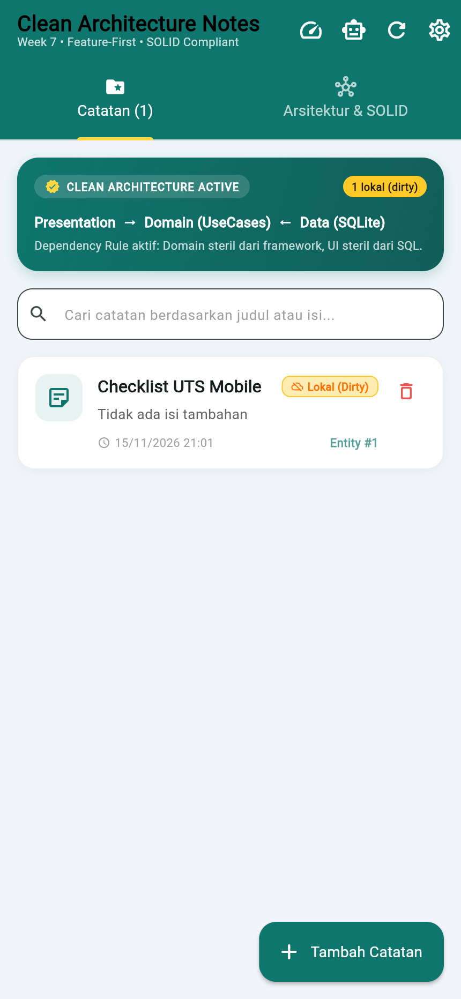
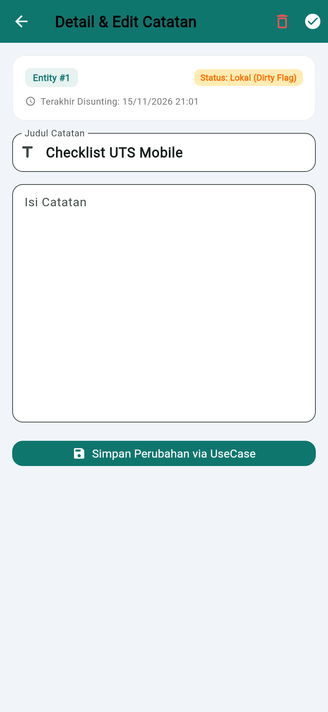

# Week 12 — Pengujian dan Jaminan Kualitas

## Status

- Test suite dibuat untuk fitur utama aplikasi **Clean Architecture Notes**
  (project Week 7–11): daftar, tambah, detail/update, hapus, dan pencarian
  catatan.
- **73 test** dijalankan: 46 test bawaan Week 7–11 + **27 test baru** Week 12
  (15 unit test dan 12 widget test).
- **1 integration test** menguji alur tambah catatan → buka detail → hapus
  memakai `main()`, navigasi, provider, dan SQLite nyata.
- `flutter analyze`: **No issues found!** (0 warning, 0 error).
- `dart format --set-exit-if-changed lib test integration_test`: **0 changed**.
- `flutter test --coverage`: **73 test lulus**, line coverage
  **803 / 1060 = 75,8%** pada 28 file.
- Integration test berjalan di **Windows desktop** (exit code 0). Perintah
  Android sudah disiapkan, tetapi perangkat uji sedang mengunci layar; kendala
  dijelaskan di bawah.
- **4 bug produksi ditemukan dan diperbaiki**, masing-masing memiliki test
  regresi:
  1. `TextEditingController` dialog tambah catatan dipakai setelah `dispose()`;
  2. bug lifecycle yang sama pada dialog API Key AI;
  3. dialog tertutup saat validasi gagal sehingga input pengguna hilang;
  4. `Row` di dalam SnackBar overflow saat teks panjang.
- Laporan lengkap ada di [`docs/testing-report.md`](docs/testing-report.md) dan
  catatan bug di [`docs/testing-findings.md`](docs/testing-findings.md).

## Dokumentasi Tangkapan Layar

> Tangkapan layar UI diambil dari build **Flutter Web profile** pada viewport
> 430 × 932 karena layar perangkat Android uji sedang mati/terkunci dan MIUI
> menolak injeksi input dari `adb`. Aplikasi, provider, dan SQLite yang dipakai
> sama dengan build Android. Tangkapan terminal berasal dari log nyata
> `flutter analyze`, `flutter test --coverage`, dan integration test Windows.

| Screenshot | Keterangan |
| :---: | :--- |
|  | **1. Hasil `flutter analyze` dan `dart format`**<br>Tidak ada issue pada seluruh `lib/`, `test/`, dan `integration_test/`; 56 file sudah terformat (0 changed). |
|  | **2. Hasil `flutter test --coverage`**<br>Seluruh 73 unit & widget test lulus tanpa kegagalan, dan `coverage/lcov.info` dihasilkan. |
|  | **3. Ringkasan Cakupan**<br>Line coverage 75,8% (803/1060 baris). Lapisan domain dan presentasi tercakup tinggi; lapisan data SQLite 0% karena diverifikasi lewat integration test, bukan unit test. |
|  | **4. Hasil Integration Test**<br>Alur utama berjalan pada Windows desktop: `00:03 +1: All tests passed!`. |
|  | **5. Validasi Input Gagal**<br>Judul kosong ditolak `AddNote`; SnackBar error tampil dan **dialog tetap terbuka** sehingga input tidak hilang. Perilaku ini dijaga oleh widget test W4. |
|  | **6. Daftar Catatan**<br>Setelah catatan ditambahkan lewat dialog, daftar menampilkan data dari repository dan badge `1 lokal (dirty)`. |
|  | **7. Halaman Detail & Edit**<br>Data yang sama tampil di form detail, siap diuji untuk update dan hapus. |

---

## Stack Teknologi

- Framework: Flutter 3.47.1 / Dart 3.13.1
- State Management: Riverpod (`flutter_riverpod ^3.4.3`)
- Database Lokal: SQLite (`sqflite ^2.4.4`, `sqflite_common_ffi` untuk
  Windows/Linux, `sqflite_common_ffi_web ^1.2.0` untuk web)
- Keamanan: `flutter_secure_storage ^9.2.4`
- Jaringan: `http ^1.2.0` (Google Gemini API)
- Navigasi: GoRouter (`go_router ^18.0.2`)
- Arsitektur: Feature-First Clean Architecture
- Pengujian: `flutter_test`, `integration_test` (SDK Flutter)

---

## Cara Menjalankan

```bash
cd 12-week-12-testing-quality-assurance
flutter pub get
flutter run
```

Menjalankan seluruh unit dan widget test:

```bash
flutter test
```

Menghasilkan laporan cakupan:

```bash
flutter test --coverage
```

Menjalankan integration test:

```bash
# Windows desktop
flutter test integration_test/app_test.dart -d windows

# Android (perangkat harus aktif dan tidak terkunci)
flutter test integration_test/app_test.dart -d ofscrc7dcaucssmv
```

Perintah verifikasi statis:

```bash
flutter analyze
dart format --set-exit-if-changed lib test integration_test
```

> Catatan Windows: build integration test dari path project yang panjang gagal
> dengan `MSB4184 ... exceeds the OS max path limit`. Build dijalankan lewat
> junction `C:\w12` → folder project agar path artefak MSBuild tetap pendek.

---

## Strategi Pengujian

### 1. Piramida Pengujian

```text
        ┌──────────────────────────────┐
        │  Integration test (1)        │  alur nyata: UI + navigasi + SQLite
        ├──────────────────────────────┤
        │  Widget test (12 baru)       │  render, validasi, dialog, error
        ├──────────────────────────────┤
        │  Unit test (15 baru)         │  aturan bisnis + fake repository
        └──────────────────────────────┘
```

| Lapisan | Yang diverifikasi | Tidak diverifikasi |
|---|---|---|
| Unit murni | aturan judul, format tanggal, ringkasan performa | UI, I/O |
| Unit + fake | `AddNote`, `UpdateNote`, `DeleteNote`, `GetNotes`; kontrak sukses/gagal repository | SQLite, jaringan |
| Widget | tampilan awal, input tidak valid, aksi sukses, error repository, pencarian | database nyata, platform channel |
| Integrasi | tambah → detail → hapus dengan `main()` dan database asli | skenario jamak, rotasi layar |

Prinsipnya: setiap test memeriksa **perilaku yang terlihat atau dijanjikan**,
bukan sekadar mengeksekusi baris kode. Tidak ada test tanpa assertion.

### 2. Fake Repository

`test/helpers/fake_note_repository.dart` mengimplementasikan `NoteRepository`
di memori. Fake ini:

- menyimpan catatan pada list dan mengurutkannya seperti query SQLite
  (`updated_at DESC`);
- mendukung `limit`/`offset` untuk menguji pagination;
- menghitung pemanggilan (`fetchCalls`, `addCalls`, `updateCalls`,
  `deleteCalls`) sehingga test dapat memastikan repository **tidak** dipanggil
  saat validasi gagal;
- dapat dikonfigurasi gagal lewat `fetchFailure`, `addFailure`,
  `updateFailure`, `deleteFailure`, dan `dirtyCountFailure`.

```dart
final fake = FakeNoteRepository(
  notes: [note],
  updateFailure: const LocalFailure('baris terkunci'),
);
```

Fake dipasang melalui `ProviderScope`:

```dart
ProviderScope(
  overrides: [noteRepositoryProvider.overrideWithValue(fake)],
  child: const MaterialApp(home: NotesPage()),
)
```

Dengan cara ini unit dan widget test tidak menyentuh SQLite, file, atau
jaringan, sehingga hasilnya deterministik dan cepat.

### 3. Determinisme dan Keterbacaan Test

- **Waktu tetap** pada data uji (`DateTime(2026, 11, 15, ...)`) agar urutan dan
  label tanggal tidak bergantung pada jam sistem.
- **Viewport 800 × 1600** pada widget test. Font default test (Ahem) membuat
  setiap glyph selebar em, sehingga layout 430 px melaporkan overflow palsu.
  Viewport lebar memisahkan artefak font dari bug layout aplikasi; overflow
  SnackBar yang nyata tetap diperbaiki di kode produksi.
- **Key widget** (`add-note-fab`, `note-title-field`, `save-note-button`,
  `detail-title-field`, `delete-note-button`, dst.) menjadi kontrak stabil
  antara test dan UI, sehingga test tidak rapuh saat teks label berubah.
- **Satu fake per test** dan `addTearDown(tester.view.reset)` menjaga test
  saling independen; tidak ada state bersama antar test.

---

## Skenario yang Diuji

Ringkasan perilaku utama; daftar lengkap 27 test baru ada di
[`docs/testing-report.md`](docs/testing-report.md).

| ID | Lapisan | Skenario | Hasil yang diharapkan |
|---|---|---|---|
| U1–U2 | Unit | Judul berisi teks / spasi di tepi | valid |
| U3–U4 | Unit | Judul kosong dan hanya whitespace (`'   '`, `'\t'`, `'\n  \n'`) | ditolak |
| U5 | Unit (**kasus tepi**) | Judul berisi zero-width space (`'\u200B'`) | valid menurut aturan saat ini — didokumentasikan sebagai temuan |
| U6 | Unit + fake | Tambah catatan sukses | tersimpan dan di-trim |
| U7 | Unit + fake | Tambah catatan judul kosong | `ValidationFailure`, repository tidak dipanggil |
| U8 | Unit + fake | Tambah catatan gagal | failure diteruskan tanpa exception |
| U9–U10 | Unit + fake | Ambil catatan sukses / gagal | data atau failure diteruskan; error **tidak** berubah menjadi daftar kosong |
| U11–U13 | Unit + fake | Update sukses / invalid / gagal | trim, validasi, dan failure sesuai kontrak |
| U14–U15 | Unit + fake | Hapus sukses / gagal | data hilang atau failure diteruskan |
| W1–W3 | Widget | Empty state, daftar berisi data, error fetch | UI sesuai state |
| W4 | Widget (**validasi**) | Judul kosong saat tambah | SnackBar validasi, dialog tetap terbuka, repository tidak dipanggil |
| W5 | Widget (**sukses**) | Tambah catatan valid | dialog tertutup, catatan muncul, SnackBar sukses |
| W6 | Widget (**kegagalan**) | Repository gagal saat tambah | error tampil, dialog dan input tetap ada |
| W7 | Widget | Pencarian `flutter` | hanya catatan yang cocok tampil |
| W8–W11 | Widget | Detail: tampil, invalid, update sukses, update gagal | form, validasi, dan navigasi benar |
| W12 | Widget | Simpan API Key AI | key di-trim, dialog tertutup tanpa error lifecycle |
| I1 | Integrasi | Tambah → detail → hapus | data konsisten dari dialog sampai database |

---

## Hasil Verifikasi

```text
PS ...\12-week-12-testing-quality-assurance> flutter analyze
Analyzing 12-week-12-testing-quality-assurance...
No issues found! (ran in 124.8s)

PS ...\12-week-12-testing-quality-assurance> dart format --set-exit-if-changed lib test integration_test
Formatted 56 files (0 changed) in 0.34 seconds.

PS ...\12-week-12-testing-quality-assurance> flutter test --coverage
00:14 +73: All tests passed!

PS ...\12-week-12-testing-quality-assurance> flutter test integration_test/app_test.dart -d windows
00:00 +0: alur utama: tambah catatan, buka detail, lalu hapus
00:03 +1: (tearDownAll)
00:03 +1: All tests passed!
```

Rincian test baru:

| File | Jumlah | Fokus |
|---|---|---|
| `test/validators_test.dart` | 5 | aturan judul, whitespace, zero-width space |
| `test/note_usecases_fake_test.dart` | 10 | use case + fake sukses/gagal |
| `test/notes_page_widget_test.dart` | 7 | daftar, dialog, validasi, error, pencarian |
| `test/note_detail_page_widget_test.dart` | 4 | detail, validasi, update, error |
| `test/ai_chat_widget_test.dart` | +1 | lifecycle dialog API key |

---

## Cakupan Pengujian

| Metrik | Nilai |
|---|---|
| Line coverage | **803 / 1060 = 75,8%** |
| File terukur | 28 |
| Branch coverage | Tidak tersedia (LCOV Dart menulis `BRF/BRH = 0/0`) |

Contoh file dengan cakupan tinggi:

| File | Baris | Coverage |
|---|---|---|
| `lib/core/validators.dart` | 2 / 2 | 100% |
| `lib/features/notes/domain/usecases/*.dart` | 25 / 25 | 100% |
| `lib/features/notes/presentation/widgets/note_tile.dart` | 86 / 86 | 100% |
| `lib/features/notes/data/repositories/cached_note_repository.dart` | 36 / 39 | 92% |
| `lib/features/notes/presentation/pages/notes_page.dart` | 250 / 288 | 87% |
| `lib/features/notes/presentation/pages/note_detail_page.dart` | 96 / 124 | 77% |

File dengan cakupan rendah:

| File | Baris | Coverage | Alasan |
|---|---|---|---|
| `note_repository_impl.dart` | 0 / 42 | 0% | Diverifikasi lewat integration test; tidak dihitung `--coverage` |
| `notes_database.dart` | 0 / 23 | 0% | Butuh SQLite nyata / FFI in-memory |
| `ai_remote_datasource.dart` | 0 / 70 | 0% | Butuh HTTP dan secure storage |

Angka ini **bukan target yang dikejar**. Lapisan domain dan presentasi — tempat
aturan bisnis dan perilaku pengguna — tercakup tinggi. Lapisan data yang
bergantung pada platform sengaja tidak disentuh unit test agar tidak rapuh, dan
diverifikasi oleh integration test. Ketiadaan branch coverage di LCOV Dart
berarti keputusan `if/else` penting diverifikasi lewat assertion perilaku.

---

## Temuan dan Perbaikan

Detail gejala, akar masalah, dan test regresi ada di
[`docs/testing-findings.md`](docs/testing-findings.md).

| # | Bug | Dampak | Perbaikan |
|---|---|---|---|
| 1 | Controller dialog tambah catatan dipakai setelah `dispose()` | Exception saat animasi keluar dialog | Dialog menjadi `StatefulWidget` yang memiliki dan melepas controller sendiri |
| 2 | Bug lifecycle sama pada dialog API Key AI | Exception serupa di fitur AI | `_ApiKeyDialog` dengan controller milik `State` |
| 3 | Dialog tertutup walau validasi gagal | Input pengguna hilang | Dialog hanya ditutup saat sukses; failure menampilkan SnackBar dan mempertahankan input |
| 4 | `Row` SnackBar overflow | Teks error panjang terpotong | Teks dibungkus `Expanded` |

Setiap perbaikan memiliki test yang **gagal sebelum** perubahan dan **lulus
sesudahnya**.

---

## Temuan yang Belum Terselesaikan

| # | Temuan | Dampak | Rencana |
|---|---|---|---|
| 1 | `'\u200B'` (zero-width space) dianggap judul valid | Catatan yang tampak kosong tetap bisa disimpan | Perketat `isValidNoteTitle` dengan normalisasi karakter tak terlihat |
| 2 | Lapisan SQLite 0% di coverage | Query dan migrasi v1→v2 tidak dilindungi test otomatis | Tambahkan test `sqflite_common_ffi` in-memory |
| 3 | Integration test hanya berjalan di Windows | Perilaku khusus Android belum tercakup | Jalankan ulang di perangkat setelah layar dapat dibangunkan |
| 4 | `test/widget_test.dart` masih placeholder | Menambah hitungan test tanpa nilai verifikasi | Hapus atau ganti dengan smoke test halaman utama |
| 5 | Judul aplikasi masih "Clean Architecture Notes (Week 7)" dan application id `com.example.week5_offline_notes` | Konsistensi penamaan modul | Perbarui saat menyentuh konfigurasi aplikasi |

### Kendala integration test Android

Perangkat `ofscrc7dcaucssmv` (Xiaomi 2312DRAABG, Android 15) berada pada kondisi
`mWakefulness=Dozing` / layar mati. Upaya yang dilakukan:

- `adb shell input tap/swipe` → ditolak MIUI dengan `INJECT_EVENTS`
  SecurityException;
- `adb shell settings put global stay_on_while_plugged_in 7` → ditolak karena
  shell tidak memiliki `WRITE_SECURE_SETTINGS`;
- `adb shell cmd power wakeup` → tidak didukung pada perangkat ini.

Karena integration test membutuhkan interaksi UI nyata, test dijalankan pada
target **Windows desktop** yang memakai kode aplikasi, provider, navigasi, dan
SQLite yang sama (lewat `sqflite_common_ffi`). Perintah Android tetap
didokumentasikan agar dapat dijalankan saat perangkat aktif.

---

## Struktur Proyek (bagian pengujian)

```text
12-week-12-testing-quality-assurance/
├── lib/
│   ├── core/validators.dart                     # aturan judul murni (bisa diuji tanpa Flutter)
│   └── features/notes/
│       ├── domain/usecases/                     # AddNote, UpdateNote, DeleteNote, GetNotes
│       ├── presentation/pages/notes_page.dart   # _AddNoteDialog + key widget
│       └── presentation/pages/note_detail_page.dart
├── test/
│   ├── helpers/fake_note_repository.dart        # fake sukses/gagal + call counter
│   ├── validators_test.dart                     # 5 test
│   ├── note_usecases_fake_test.dart             # 10 test
│   ├── notes_page_widget_test.dart              # 7 test
│   ├── note_detail_page_widget_test.dart        # 4 test
│   ├── ai_chat_widget_test.dart                 # 4 test (1 baru)
│   └── ...                                      # 46 test bawaan Week 7–11
├── integration_test/app_test.dart               # tambah → detail → hapus
├── docs/
│   ├── testing-report.md                        # strategi, hasil, coverage
│   └── testing-findings.md                      # bug, akar masalah, regresi
└── screenshots/                                 # bukti analyze, test, coverage, integrasi, UI
```

---

## Refleksi

1. **Bug apa yang paling mungkin terlewat tanpa pengujian yang ditulis?**  
   Bug `TextEditingController was used after being disposed` adalah kandidat
   terkuat. Secara manual, dialog terlihat tertutup normal; exception hanya
   muncul pada frame animasi keluar ketika `TextField` masih membaca controller.
   Test widget menunggu `pumpAndSettle()` dan memeriksa kondisi setelah dialog
   hilang, sehingga siklus hidup controller ikut teruji. Bug kedua — dialog
   tertutup saat validasi gagal — juga mudah terlewat karena pesan error tetap
   muncul; yang hilang adalah input pengguna, bukan pesannya.

2. **Bagian mana yang perlu fake, dan bagaimana fake membuat pengujian lebih
   konsisten?**  
   Repository adalah batas paling tepat untuk di-fake. Unit test use case tidak
   perlu SQLite, dan widget test tidak perlu database atau platform channel.
   Fake yang dapat dikonfigurasi gagal membuat skenario error dapat diuji
   berulang kali dengan hasil sama, tanpa bergantung pada isi database
   perangkat. Penghitung pemanggilan juga membuktikan bahwa validasi benar-benar
   menghentikan akses data, bukan hanya menampilkan pesan.

3. **Apa perbedaan nilai pengujian widget dan integrasi pada fitur ini?**  
   Widget test cepat dan presisi: ia memverifikasi teks, SnackBar, status dialog,
   dan jumlah pemanggilan repository untuk satu state UI. Integration test
   menjawab pertanyaan berbeda: apakah semua bagian — `main()`, GoRouter,
   provider, use case, repository, dan SQLite — benar-benar tersambung pada
   perangkat. Widget test bisa lulus meskipun wiring database rusak; integration
   test bisa lulus meskipun detail copy UI berubah. Keduanya saling melengkapi
   dan tidak saling menggantikan.

4. **Apakah coverage 75,8% berarti aplikasi sudah aman?**  
   Tidak. Angka itu menunjukkan baris yang dieksekusi, bukan perilaku yang
   diperiksa. Lapisan SQLite justru 0% karena hanya diuji lewat integration
   test, dan kasus tepi seperti zero-width space masih terbuka. Karena itu
   laporan ini mencantumkan temuan yang belum terselesaikan secara eksplisit,
   bukan mengejar persentase.

---

## Referensi

- [Testing Flutter apps](https://docs.flutter.dev/testing/overview)
- [Introduction to widget testing](https://docs.flutter.dev/cookbook/testing/widget/introduction)
- [Integration testing](https://docs.flutter.dev/testing/integration-tests)
- [Dart test package](https://pub.dev/packages/test)
- [sqflite_common_ffi](https://pub.dev/packages/sqflite_common_ffi)
